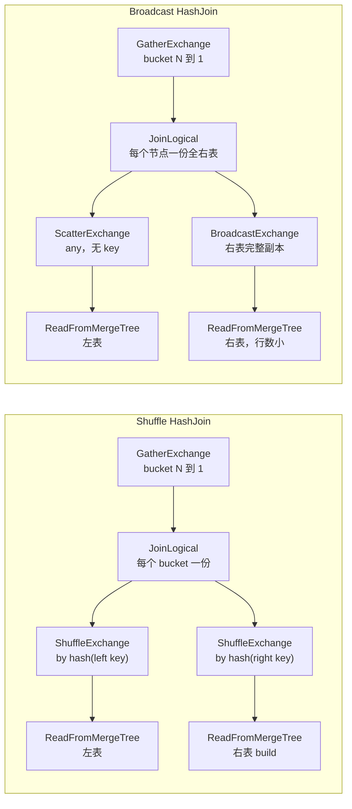
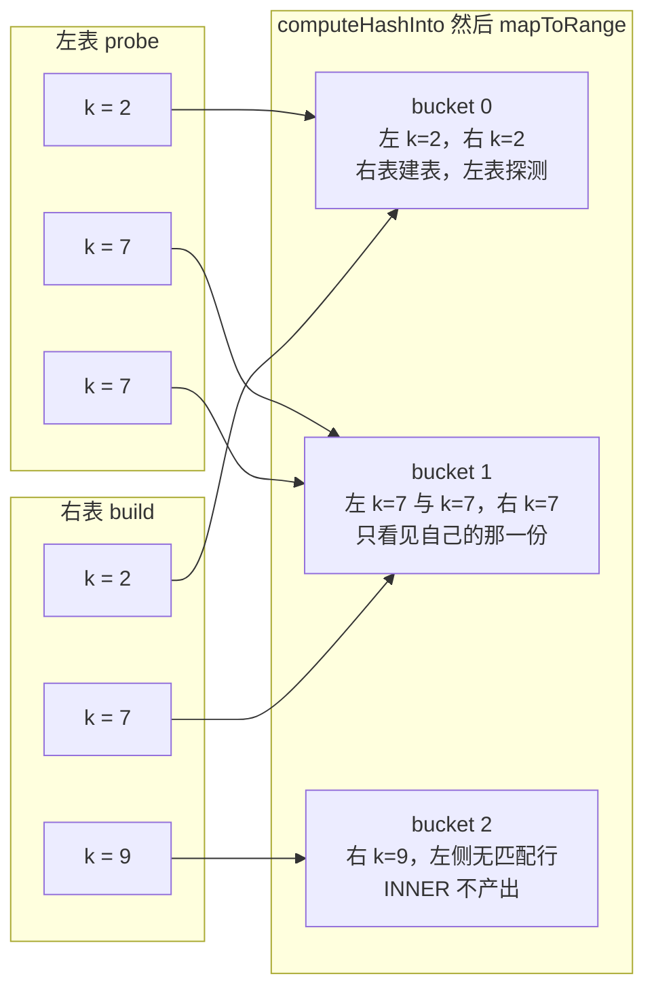
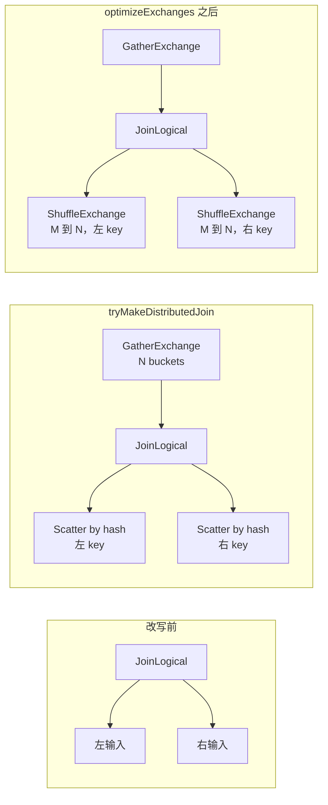
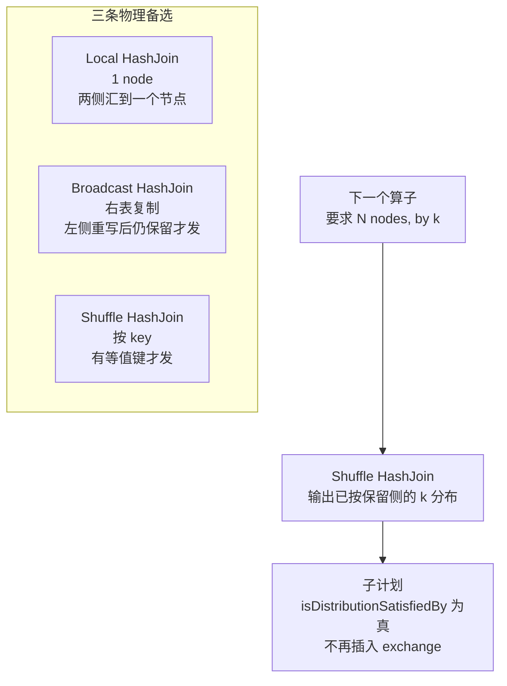
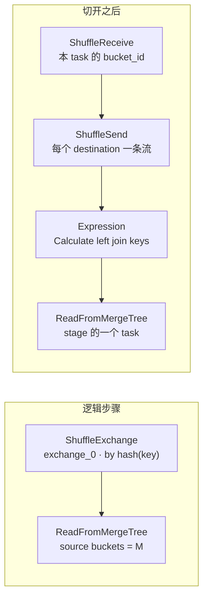
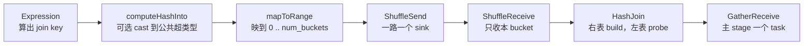
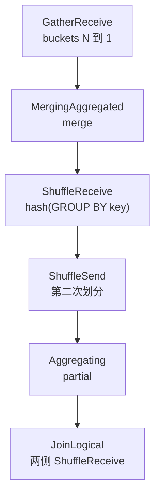

# ClickHouse 分布式 JOIN：等值键如何被送进同一个 bucket

> **目录**：[README.md](./README.md)
> **图表**：图 1 到图 6 用 [Mermaid](https://mermaid.js.org/) 画在对应段落旁边。GitHub 直接打开本文件即可渲染。这些图是规划步骤的示意图，不是 `EXPLAIN` 原文。

两张大表做等值 JOIN 时，每个执行任务不需要看见另一张表的全部行。打开 `make_distributed_plan` 之后，ClickHouse 可以把左右两侧按 join key 散列进同一组 bucket：key 相同的行进入同一个 bucket，每个 bucket 只用自己的那一份做哈希表的 build 和 probe，JOIN 结果再汇合，或者被下一个算子按另一组 key 重新划分。

这条路径默认是关的。`make_distributed_plan` 在 `src/Core/Settings.cpp` 里是 private preview，默认 `false`。不打开它，查询仍走单机计划。没有等值条件、写成 `LOCAL JOIN`、或者规划器选择把右表整份复制时，行也不会按 join key 重新分桶。

源码里没有叫 shuffle join 的 SQL 语法，也没有名为 `ShuffleJoin` 的步骤。社区说的 shuffle join，就是上面这段数据移动。Cascades 给它的策略名是 `Shuffle HashJoin`。规则规划器在代码里把它写成枚举值 `Shuffle`。真正搬数据的步骤，切开计划之后叫 `ShuffleSend` 和 `ShuffleReceive`。

## 默认关掉，打开之后并行副本也不再参与

`make_distributed_plan` 的说明写着：打开它会自行做工作分配，并把 `enable_parallel_replicas`、`automatic_parallel_replicas_mode` 调成 0，同时关掉 `correlated_subqueries_use_in_memory_buffer`、`compile_expressions` 和 `query_plan_direct_read_from_text_index`。所以这套 exchange 和并行副本是两条机制。文章后面的计划都假定这个开关已经打开。

计划里出现还不支持分布式执行的步骤时，`distributed_plan_fallback_to_local_execution`（默认 `true`）会打日志，改在发起节点执行。把它设成 `false`，得到的是 exception，例如不支持的步骤被拒绝，或者 bucket 数超过 `ReadFromMergeTree::max_distributed_read_buckets` 时 `validateBucketCount` 抛出的 `INVALID_SETTING_VALUE`。进程不会因此崩溃。

调试时可以用 `distributed_plan_execute_locally`：全部 task 仍在本机跑，exchange 还在。它适合对照计划，不代表生产部署。

## 源码里的五个名字

读计划之前先把五个名字分开。图 2 把 shuffle 和 broadcast 的树并排放着，下面这张表是同一件事的索引。

**图 2.** shuffle 与 broadcast 的计划形状。左侧两侧都按 join key 划分；右侧右表整份复制，左表是无 key 的 scatter。



| 你想说的 | 代码里的名字 | 行怎么走 |
| --- | --- | --- |
| shuffle join | 规则规划器：`tryMakeDistributedJoin` 里的 `DistributedJoinStrategy::Shuffle`。Cascades：`ShuffleJoinStrategy`，`getName` 返回 `Shuffle HashJoin`。数据面：`ShuffleExchange`，或按 key 的 `ScatterExchange`。切开后是 `ShuffleSend` + `ShuffleReceive`。 | 两侧按 join key 进入同一组 bucket。每个 bucket 只 build 自己的那一份。 |
| broadcast join | `BroadcastJoinStrategy` / `Broadcast HashJoin`。右侧是 `BroadcastExchange`，左侧是无 key 的 `ScatterExchange`。fragment 打印成 `any`，不是 `hash(...)`。 | 右表整份复制到每个 bucket。左表不按 join key 散列。 |
| 单机 JOIN | `LocalJoinStrategy` / `Local HashJoin`。 | 两侧先汇到一个节点，再做普通 JOIN。 |
| `LOCAL JOIN` | `JoinLocality::Local`。`src/Core/Joins.h` 的注释是：只用同一批服务器上已经有的数据。 | 规则规划器在 `tryMakeDistributedJoin` 开头直接 return，不插入 shuffle 或 broadcast。Cascades 在 `getReasonCascadesCannotDistribute` 里拒绝整条计划，原因字符串是 `make_distributed_plan with enable_cascades_optimizer does not support LOCAL JOIN`。 |
| 已经按同一把 key 分布 | 只有 Cascades。`ExpressionProperties::isDistributionSatisfiedBy` 为真时，`DistributionEnforcer` 不再插入 exchange。 | `node_count`、key 的顺序、`hash_type_names` 都要一致。按 `(b, a)` 散列的数据，满足不了要求 `(a, b)` 的父节点。 |

`GLOBAL JOIN` 只把 locality 设成 `JoinLocality::Global`。这个枚举的注释是：从远程服务器收集数据，再广播到每台服务器。那是 `Distributed` 表和 `distributed_product_mode` 的旧语义，改写在 `src/Storages/buildQueryTreeForShard.cpp`。新规划器里，`tryMakeDistributedJoin` 允许 `Unspecified` 和 `Global` 两种 locality 进入后面的选择，策略仍由行数估计或代价决定。写出 `GLOBAL` 这个关键字，既不会单独变成 shuffle，也不会单独变成 broadcast。

还有一条容易混进来的单机优化：`optimizeJoinByShards`。它按主键范围把一个节点上的 JOIN 切开，文件里的注释写明中间没有 repartitioning。它不产生 `ShuffleExchange`。

图 1 是 shuffle 本身。左表的 `k = 2` 和右表的 `k = 2` 进同一个 bucket，`k = 7` 进另一个。bucket 里的右表行用来建哈希表，左表行用来探测。图里的 bucket 编号是示意，不是这几个字面 key 经过 `mapToRange` 之后的真实编号。

**图 1.** 相同 join key 进入同一个 bucket。编号是示意。散列发生在 `ShuffleSendStep` 调用的 `scatterByPartition`：`computeHashInto`，再 `mapToRange`。



## 规则规划器：先包 Scatter，再收成 Shuffle

`enable_cascades_optimizer` 默认 `false`。它只有和 `make_distributed_plan` 同时为 1 才改变分布式计划。两者只开前者时，走的是 `src/Processors/QueryPlan/Optimizations/makeDistributed.cpp` 里的 `tryMakeDistributedJoin`。

调用顺序在 `optimizeTree`：`optimizeJoinLogical` 先跑，分布式改写在后。join order 和 `query_plan_join_swap_table` 会决定哪一侧是右表。规则规划器的 broadcast 启发式看的就是右表的估计行数，所以换边会改变这次 JOIN 走不走 shuffle。`query_plan_optimize_join_order_conflict_detector` 只决定哪些 JOIN 能被摊平重排，不插入 exchange。

对一个恰好有两个输入的 `JoinStepLogical`，`tryMakeDistributedJoin` 按这个顺序决定：

1. locality 不是 `Unspecified` 也不是 `Global`，函数 return。`LOCAL JOIN` 因此不会被包进 exchange。
2. 谓词里没有任何 `JoinConditionOperator::Equals`，函数 return。`CROSS JOIN` 和纯不等式走不到 shuffle。
3. 右表估计行数存在，并且不超过 `distributed_plan_max_rows_to_broadcast`（默认 20000），同时 JOIN 的 kind 不是 `Right` 也不是 `Full`，就选 broadcast。估计缺失时这个条件不成立，保持 shuffle。
4. 否则走 shuffle。先调用 `shuffleJoinKeysHaveCommonType`。任何一对等值键没有公共超类型，函数 return，JOIN 留在单机。这个检查必须发生在 `preCalculateKeys` 之前：事后再放弃，会留下孩子产生不了的输入，反序列化时是 `LOGICAL_ERROR`。
5. `JoinStepLogical::preCalculateKeys` 抽出两侧的 key。需要计算的一侧加上 `Expression`，描述是 `Calculate left join keys` 或 `Calculate right join keys`。类型不同时，两侧的 `hash_cast_types` 都设成公共超类型。这个 cast 只用于散列，输出行保持原来的类型。
6. 两侧各放一个按 key 的 `ScatterExchange`，描述形如 `by hash([...])`，bucket 数是 `distributed_plan_default_shuffle_join_bucket_count`（默认 8）。JOIN 挪到它们上面，再盖一个同样 bucket 数的 `GatherExchange`。

读入是另一条改写。`tryMakeDistributedRead` 对足够大的 `ReadFromMergeTree` 调用 `setupDistributedReadBuckets`，上面再盖 `GatherExchange`。估计行数不超过 `distributed_plan_max_rows_to_broadcast` 的读不切开。`distributed_plan_default_reader_bucket_count` 为 0 时，读任务数按 `distributed_plan_min_rows_per_reader`（默认 1000000）和 worker 数计算。这三项都只给规则规划器。

然后 `optimizeExchanges` 自底向上走。`tryReplaceScatterGatherWithShuffle` 看到 Scatter 紧挨在 Gather 上，就换成 `ShuffleExchange`：source bucket 数取 Gather 的，result bucket 数取 Scatter 的，key 和 `hash_cast_types` 从 Scatter 抄过来。`ShuffleExchangeStep` 的类注释写的是：把 M 路逻辑流按 key 重新分成 N 路。空 key 且两侧 bucket 数相同的 shuffle 会被删掉；等值 JOIN 的 key 不为空，删不掉。

所以 `EXPLAIN actions = 1` 里常见的形状，是 `ShuffleExchange (by hash([...]))` 直接盖在读上面，而不是先 Gather 再 Scatter。那是收起，不是跳过按 key 的划分。图 3 的三帧就是：改写前的 `JoinLogical`，包上 Gather 和两侧 Scatter，再收成两侧 `ShuffleExchange`。

**图 3.** 规则规划器的两步改写。`enable_cascades_optimizer = 0` 时，`tryMakeDistributedJoin` 先包 `GatherExchange` 和两侧按 key 的 `ScatterExchange`，`optimizeExchanges` 再收成 `ShuffleExchange`。key 还在。



没有 `Equals` 谓词、locality 是 `JoinLocality::Local`、或等值键没有公共超类型时，`tryMakeDistributedJoin` 直接 return，不会包上图 3 这一层。右表估计行数不超过 `distributed_plan_max_rows_to_broadcast` 且 kind 不是 `Right` / `Full` 时走 broadcast，也不走这张图。

`Right` 和 `Full` 不能走 broadcast。右表被复制之后，每个 worker 只看见左表的一片，却都会输出自己认为未匹配的右行，结果是重复行。规则规划器用 `broadcast_unsafe` 把这两种 kind 留在 shuffle。

## Cascades：三条 HashJoin，胜出的才留下

`enable_cascades_optimizer = 1` 时，`optimizeTree` 不再调用 `tryMakeDistributedJoin`。`HashJoinImplementation`（`src/Processors/QueryPlan/Optimizations/Cascades/Rules/HashJoinImplementation.cpp`）对同一个逻辑 JOIN 生成物理备选：

- `addLocalJoin`：两侧都汇到一个节点。集群只有一个节点时只发这一条，因为另外两条会得到同一棵计划。
- `addBroadcastJoins`：左表按任意方式分到 N 个节点，右表复制。仅当左侧重写后仍保留时才发。`joinPreservesLeftSide` 对 `Inner`、`Left`、`Cross`、`Comma` 返回真。`Right` 和 `Full` 不发。`JoinCommutativity` 可以把一部分 `RIGHT` 的 Semi、Anti、Any 换成 `LEFT`，换不了 `RIGHT ALL` 和 `FULL`。
- `addShuffleJoin`：有等值键、节点数大于 1 才发。两侧都要求按这些 key 分布。
- `addSingleKeyShuffleJoins`：等值键至少两对时，为每一对再发一个备选，描述后缀是 `(by <左键>)`。注释写明正确性：只按 `A = A'` 散列时，`A` 相等的行已经在同一节点，`B = B'` 留在本地哈希表里检查。

这三条分布式策略还要求 `join_algorithm` 允许 `hash`、`grace_hash` 或 `auto`（`allowsHashFamilyAlgorithm`）。否则只留下单机备选，JOIN 不会被拆到多个节点。

分布对不上时，`DistributionEnforcer::addKeyedShuffle` 补 exchange。源在一个节点上，用 `ScatterExchangeStep`；源已经在多个节点上，用 `ShuffleExchangeStep`。源是多节点上的完整副本时，这个函数直接不发 shuffle：把每一份副本再散列一遍，行数会乘上副本数。

父节点要求的分布如果已经被子节点满足，`DistributionEnforcer::checkPattern` 为假，不再插入 exchange。这是源码里最接近「两侧已经按同一把 key 对齐」的行为，但代码不叫 co-partitioned join。规则规划器没有这道检查。`FULL` 不保留任何一侧，`addShuffleJoin` 可能不把 key 写进输出分布，下一次 JOIN 就不能假定自己还坐在上一次的 bucket 上。

代价比较不用 `distributed_plan_default_shuffle_join_bucket_count`，也不用 `distributed_plan_max_rows_to_broadcast`。这两句写在 setting 自己的说明里。Cascades 只比较 `{1 node}` 和 `{N nodes}`。N 来自 stateless worker 配置；测试里可以用 `param__internal_cascades_cluster_node_count` 覆盖。定不了 N 时，查询被拒绝，而不是静默当成单机。

胜出的策略名写进步骤描述。`cloneStepForBestPlan` 在策略是 `IJoinStrategy` 时，把描述设成 `Shuffle HashJoin`（或 `Broadcast HashJoin`、`Local HashJoin`）加上原描述。单键备选中间还有 `(by ...)`。

图 4 是这三条备选，以及「分布已经满足就不再加 exchange」的那一帧。

**图 4.** 同一个逻辑 JOIN 的三个物理备选。fan-out 不用 `distributed_plan_default_shuffle_join_bucket_count`。分布已经满足时，`DistributionEnforcer` 不再插入 exchange。



`DistributionEnforcer::checkPattern` 在要求已被满足时不产生 enforcer。key 顺序和 `hash_type_names` 必须一致，`(b, a)` 满足不了 `(a, b)`。`FULL` 不保留任何一侧，输出不一定还能广告 join key。规则规划器没有这道检查。

## 逻辑 exchange 不发送数据

`ShuffleExchangeStep::transformPipeline` 和 `ScatterExchangeStep::transformPipeline` 都是空函数。注释写着：直接执行时不改变 pipeline。发送发生在 `makeDistributedPlan` 把逻辑步骤切成 sink 和 source 之后。

`ScatterExchangeStep` 的实现注释写明：Scatter 是 source bucket 数为 1 的 shuffle，所以 sink 和 source 仍然是 `ShuffleSendStep` 和 `ShuffleReceiveStep`。source shard 数不是 1 时，这里抛 `LOGICAL_ERROR`。`ShuffleExchangeStep::createSinkAndSourcePair` 同样产出这一对，result bucket 数作为 `num_buckets`。

`makeDistributedPlan` 给每个逻辑 exchange 一个名字 `exchange_<id>`。`distributed_plan_force_exchange_kind` 设成 `Persisted` 时，数据进对象存储的临时文件；其他值（包括空字符串）用 `Streaming`。`FragmentGraph.h` 里的注释把两者分开：Streaming 是边生产边发送，生产者和消费者同时跑；Persisted 是消费者等生产者写完。streaming 的压缩由 `distributed_plan_exchange_compression_method` 决定，默认 `LZ4`。落文件的 exchange 用 server 的默认 codec。

切开之后，每个 destination bucket 是一个 task，参数里有 `bucket_id` 和 `total_buckets`。每个发送 task 对每个 destination bucket 有一条 `ExchangeStreamId`，三个字段是 exchange 名、source shard、destination shard。JOIN 的 stage 依赖把右输入插到左输入之前。`JoinStepLogical::getBuildSide` 返回 `JoinTableSide::Right`，所以喂 build 侧的 stage 先启动。这是 stage 顺序。本地哈希表要等右表到齐才探测左表，那是 bucket 里面的 JOIN 算法自己的事。

图 5 左边是还没切开的 `ShuffleExchange`，右边是 `ShuffleSend` 在下、`ShuffleReceive` 在上。中间的网或临时文件，就是这个 `exchange_<id>`。

**图 5.** 逻辑 `ShuffleExchange` 切开之后才发送。`transformPipeline` 是空的。`makeDistributedPlan` 把 Shuffle 和按 key 的 Scatter 都切成 `ShuffleSend` + `ShuffleReceive`。



| 谁 | 做什么 | 代码 |
| --- | --- | --- |
| 发送 task | 按 key 把块拆成 N 路，每路一个 sink | `ShuffleSendStep::updatePipeline` |
| 流 | `ExchangeStreamId(exchange, source, destination)` | `makeDistributedPlan` |
| 接收 task | 只读发往自己 `bucket_id` 的流 | `ShuffleReceiveStep` |
| `Streaming` | 边生产边发送 | `StreamingExchangeSink` / `StreamingExchangeSource` |
| `Persisted` | 先写临时文件，消费者等生产者结束 | `distributed_plan_force_exchange_kind` |

右输入是 build 侧（`JoinStepLogical::getBuildSide` 返回 `Right`）。喂右侧的 stage 排在喂左侧的 stage 之前。这是 stage 启动顺序，不是网络层等哈希表建完才放行左表。

`EXPLAIN fragments = 1` 的 exchange 列表由 `PreparedFragmentGraph::formatExchangeKind` 打印。带 key 的 `ShuffleExchange` 和 `ScatterExchange` 在 `FragmentGraph.cpp` 里标成 `Hash`，打出来是 `hash(键)`。空 key 标成 `Any`，打出来是 `any`。`BroadcastExchange` 是 `broadcast`，`GatherExchange` 是 `gather`。传输模式是 `streaming` 或 `persisted`。

## 一行怎样被散列，又在哪个 bucket 里被探测

`ShuffleSendStep::updatePipeline` 先把 pipeline 的流数收到最多 16。有 key 时调用 `scatterByPartition`，无 key 时调用 `scatterRoundRobin`。无 key 的那条是 broadcast 的左表，或者部分聚合前面的 “any” scatter，不要把它读成 hash shuffle。

`ScatterByPartitionTransform` 对每个块：key 类型和 `hash_cast_types` 不一致就先 cast，然后 `computeHashInto`，再 `mapToRange`。`src/Common/MapToRange.h` 写的是用乘加移位把 32-bit hash 均匀映到 `[0, range_size)`，专门避开 `h % n`。然后 `IColumn::scatter` 把行拆进各输出。每个输出接一个 sink。Streaming 时这个 sink 是 `StreamingExchangeSink`，对端是 `StreamingExchangeSource`。

`ShuffleReceiveStep::initializePipeline` 读本 task 的 `bucket_id`，只收集发往这个 bucket 的流。注释写明 shuffle 之后块的顺序无关，接收在多个线程上跑。有序合并只属于带 `maintain_sort_description` 的 `GatherExchange`。shuffle join 上面那次 gather 不带这组排序。

每个 bucket 上的 JOIN 在计划里仍是 `JoinLogical`。`convertLogicalJoinToPhysical` 看到 `make_distributed_plan` 就返回 false，逻辑 JOIN 被序列化到 worker。worker 执行这个 fragment、重新优化时，才走到 `JoinStepLogical::buildPhysicalJoin`，调用 `chooseJoinAlgorithm`（`src/Planner/PlannerJoins.h`），得到 `HashJoin`、`GraceHashJoin` 或其他 `IJoin`，由 `JoiningTransform` 执行。等值条件以外的剩余谓词在这次本地 JOIN 上检查。

`GraceHashJoin::repartitionCurrentBucket` 是这个本地算法在内存压力下把当前 bucket 再劈开、一半落盘。它和分布式的 `ShuffleExchange` 用了同一个英文词，不是同一次数据移动。

图 6 把一条行的去向接成一条线：算出 key，`computeHashInto`，`mapToRange`，`ShuffleSend`，`ShuffleReceive`，右表 build、左表 probe，最后 `GatherReceive`。主 stage 在 `makeDistributedPlan` 结束时只有一个 task，名字是 `main`。

**图 6.** 一行从算出 key 到主 stage 收齐。类型不一致时，cast 只发生在散列之前，输出行保持原类型。`GraceHashJoin::repartitionCurrentBucket` 不在这条线上。



如果 JOIN 上面还有 `GROUP BY`，规则规划器可以让 `Aggregating` 的 partial 留在 JOIN 的那些 bucket 里，再按分组键做另一次 shuffle，上面才是描述为 `merge` 的 `MergingAggregated`。那一次的步骤名同样是 `ShuffleSend` 和 `ShuffleReceive`，hash 的是分组键。`distributed_plan_force_shuffle_aggregation` 管的是这次聚合，不管 JOIN 本身。图 6 下半截就是这两次 hash 叠在一起的形状。

**图 6 下半截.** JOIN 的 shuffle 之上，按分组键再划分一次。两次 `hash(...)` 的 key 不同。



## 三组查询，用来核对计划

下面三组是投稿前要换成真实 `EXPLAIN` 的位置。查询和 setting 可以直接跑。步骤名是源码会发出的名字，无状态测试 `03394_distributed_shuffle_join_with_prewhere.reference` 和 `05339_explain_plan_fragments.reference` 断言过同样的形状。列的内部名和行数会随表变化，不要把那两份 reference 原样贴进文章。

固定这几项，避免左右侧和 JOIN 顺序被测试框架随机化改掉：`query_plan_optimize_join_order_randomize = 0`，`query_plan_join_swap_table = 0`。表用两张本机 `MergeTree`。不要再设置已经 obsolete 的 `query_plan_use_new_logical_join_step`。

### 强制走 shuffle

```sql
EXPLAIN actions = 1
SELECT count()
FROM big
INNER JOIN small ON small.sid = (big.bid + 1) % 5000
SETTINGS
    make_distributed_plan = 1,
    enable_cascades_optimizer = 0,
    enable_parallel_replicas = 0,
    distributed_plan_max_rows_to_broadcast = 0,
    distributed_plan_default_shuffle_join_bucket_count = 3,
    distributed_plan_default_reader_bucket_count = 3,
    distributed_plan_optimize_exchanges = 1,
    distributed_plan_force_exchange_kind = 'Streaming',
    distributed_plan_fallback_to_local_execution = 0,
    query_plan_join_swap_table = 0;
```

`distributed_plan_max_rows_to_broadcast = 0` 用来压住 broadcast 启发式。表达式键会逼出 `Calculate left join keys` 或 `Calculate right join keys`。

投稿前替换：这里贴真实的 `EXPLAIN actions = 1`。应当能看见 `JoinLogical`，两侧 `ShuffleExchange`，描述里有 `by hash([...])`，叶子是 `ReadFromMergeTree`。

同一条查询再跑 `EXPLAIN fragments = 1`。

投稿前替换：这里贴真实的 `EXPLAIN fragments = 1`。应当能看见读 fragment 上的 `ShuffleSend`，JOIN fragment 上两个 `ShuffleReceive` 夹着 `JoinLogical`，Exchanges 段里是 `hash(...)`、`streaming`、`buckets 3 -> 3`。

### JOIN 之后，聚合再按另一把 key 划分

把上面的查询换成 `SELECT small.sid, count() ... GROUP BY small.sid`，setting 不变。

投稿前替换：这里贴 `EXPLAIN fragments = 1`。应当能看见 JOIN 那一层的 `ShuffleReceive` 上面是描述含 `partial` 的 `Aggregating`，再以 `ShuffleSend` 结束；再上一层是 `ShuffleReceive` 喂给 `MergingAggregated`（描述 `merge`），然后 `GatherSend`；主 fragment 是 `GatherReceive`。Exchanges 段里有两条不同的 `hash(...)`：一条是 join 表达式，一条是分组键，最后一条是 `gather`，`buckets 3 -> 1`。

### 同一形状走 broadcast，以及 Cascades 的策略名

右表只有大约一千行时，把 `distributed_plan_max_rows_to_broadcast` 设成 `1000000`，其余与第一组相同。`Right` 和 `Full` 不能用这个对照。

投稿前替换：这里贴 `EXPLAIN fragments = 1`。左表那条 exchange 应打印成 `any`，`buckets 1 -> 3`。右表是 `BroadcastSend` 和 `BroadcastReceive`，打印成 `broadcast`。

另起一条等值 JOIN，加上 `enable_cascades_optimizer = 1`。本机没有 stateless worker 配置时，还要设置 `param__internal_cascades_cluster_node_count` 为大于 1 的整数，否则 Cascades 会拒绝查询。

投稿前替换：这里贴 `EXPLAIN actions = 1`。若胜出的是 shuffle，JOIN 的步骤描述以 `Shuffle HashJoin` 开头。这是代价比较的结果，文章只贴真实计划，不预先断言它一定不选 broadcast。

## 读计划时可以靠这几条停下来

- 描述是 `by hash([...])` 或 exchange 行是 `hash(...)`：这是按 key 的划分，也就是本文的 shuffle。
- exchange 行是 `any`：无 key 的 scatter。broadcast 的左表是这种，不是 hash。
- exchange 行是 `broadcast`：右表整份复制。
- 步骤描述以 `Shuffle HashJoin` 开头：Cascades 选了 shuffle。以 `Broadcast HashJoin` 或 `Local HashJoin` 开头，就是另外两条。
- `buckets 3 -> 3` 是重新划分。`buckets 3 -> 1` 的 `gather` 是把结果收回主 stage。
- 计划建不出来时看的是 exception 文本，或者 `distributed_plan_fallback_to_local_execution` 打出的退回本地执行的日志。

图 1 到图 6 对应上面这几段：bucket 里有什么、shuffle 和 broadcast 的树、规则规划器的两步改写、Cascades 的三条策略、exchange 切开、一行从 key 到 `GatherReceive`。对照着看，`ShuffleExchange` 和 `ShuffleSend` 就是同一次划分的两层名字。
