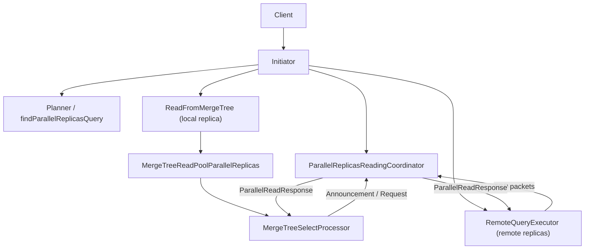
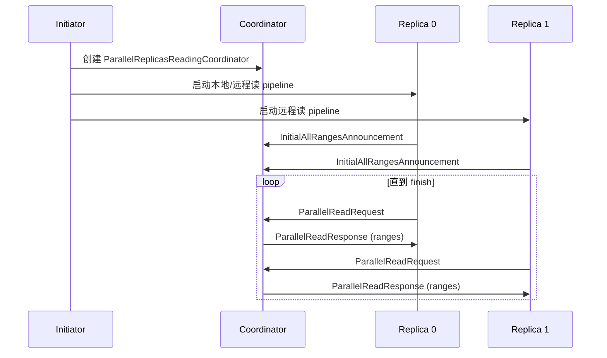
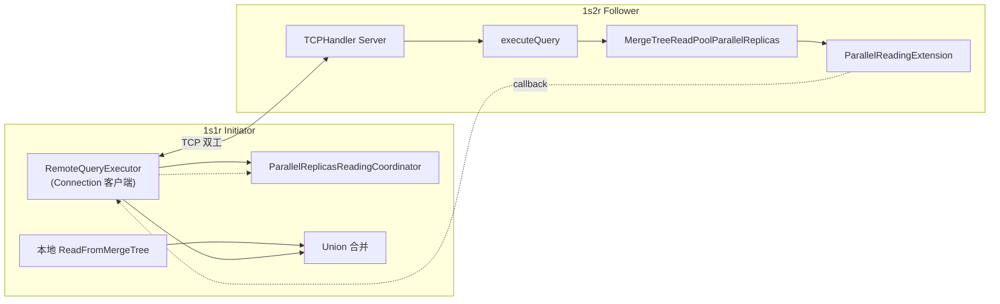
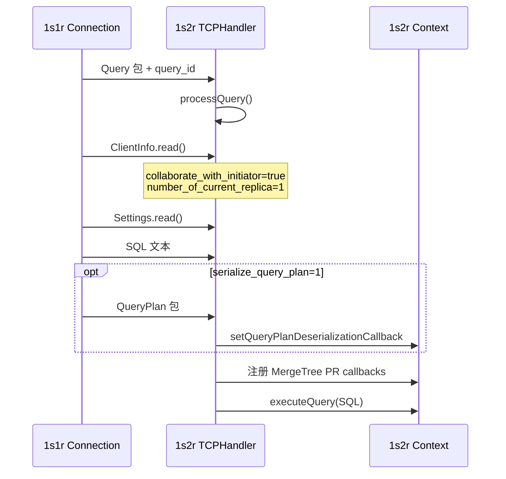
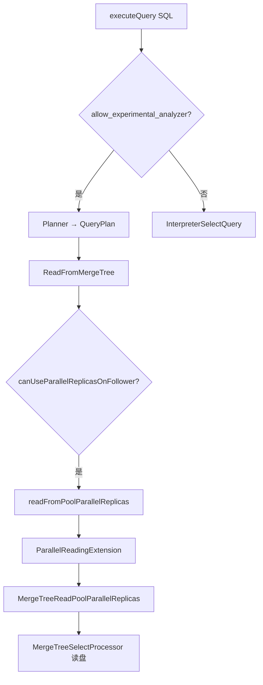
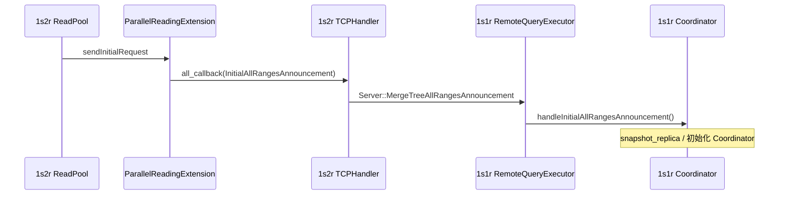
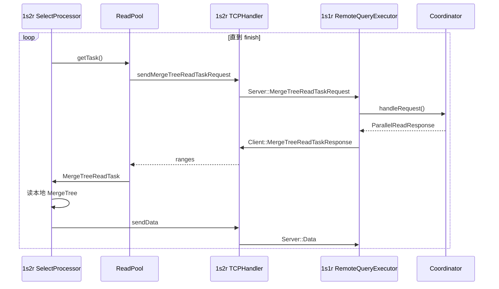

# Parallel Replicas 读路径源码分析

> **适用版本**：ClickHouse 26.2  
> **目标读者**：需要分析 parallel replicas 执行计划、排查多副本读行为的开发 / DBA  
> **源码根目录**：`/root/work/26.2/clickhouse/src`  
> **文档状态**：骨架（待逐节填充）

---

## 0. 阅读指引

### 0.1 本文覆盖范围

- **覆盖**：单 shard 多副本并行读（`cluster_for_parallel_replicas`），主线为 `parallel_replicas_mode = read_tasks` 下的 mark 级协调。
- **不展开**（仅简要提及）：`CUSTOM_KEY_*`、`SAMPLING_KEY` 模式的完整实现；跨 shard 的 Distributed 全局调度细节。

### 0.2 前置知识

- MergeTree 的 part / mark / granule 概念
- `ReadFromMergeTree` 与 `MergeTreeReadPool` 基本流程
- `RemoteQueryExecutor` 与 Distributed 读的基本路径

### 0.3 建议源码阅读顺序

```text
Planner（能否启用）
  → ClusterProxy/executeQuery（initiator 组装 pipeline）
  → ParallelReplicasReadingCoordinator（任务分配）
  → MergeTreeReadPoolParallelReplicas + MergeTreeSelectProcessor（副本读侧）
  → RemoteQueryExecutor + TCPHandler（网络协议）
  → §9 Follower 全路径（1s2r 收包 / callback / 读循环）
```

与 [附录 A：源码文件索引](#附录-a源码文件索引按层) 对照使用。

---

## 1. 背景：Parallel Replicas 解决什么问题

### 1.1 问题陈述

在 ReplicatedMergeTree 的典型部署里，**同一个 shard 往往有 2～3 个（或更多）副本**，各副本通过复制保持数据一致。但传统读路径下，一次 SELECT 在某个 shard 上通常**只连一个 replica**（由 `load_balancing` 等策略选出），由该节点独自完成该 shard 上全部 part 的 mark 扫描、索引过滤、列解压与表达式计算。当查询扫描量大、并发高，或单表 part 数很多时，**磁盘带宽、页缓存命中、CPU 解压/解码**都会集中压在这一个节点上，成为 shard 内的读瓶颈；其余副本虽然持有相同数据，却在该查询中处于闲置状态。

Parallel Replicas 针对的正是这一点：**数据在副本间是冗余的，但 IO 与 CPU 不必冗余地堆在同一副本上**。理想情况下，同一条查询可以把「要读的 mark 范围」拆成多份，让同一 shard 上的多个 replica 各读一部分，再在 initiator 侧合并结果流。由于各副本读的是同一套 MergeTree 数据的子集，**不会也不应产生重复行**；难点在于如何在运行时知道每个副本当前能读哪些 part、如何把 mark 切分得均衡、以及副本宕机或 part 可见性不一致时如何 steal 任务而不漏读。

因此，Parallel Replicas 在引擎层引入 **Coordinator + 副本间协议**（`InitialAllRangesAnnouncement` / `ParallelReadRequest` / `ParallelReadResponse`），在 `max_parallel_replicas` 控制下动态分配 mark 级读任务。它解决的是 **单 shard 内「多副本算力闲置、单副本读打满」** 的问题，而不是替代 Distributed 的跨 shard 分片；二者可以叠加（Distributed 负责 shard 间，Parallel Replicas 负责 shard 内多副本并行）。

### 1.2 与普通 Distributed 读的区别

| 对比项 | 普通 Distributed 读 | Parallel Replicas |
|--------|---------------------|-------------------|
| 连接对象 | 每个 shard 通常选一个 replica | 同一 shard 上多个 replica 协同 |
| 数据划分单位 | shard | part / mark segment |
| 运行时协调 | 无 | `ParallelReplicasReadingCoordinator` |
| 典型 Setting | `load_balancing` | `max_parallel_replicas`, `cluster_for_parallel_replicas` |

---

## 2. 角色与整体架构

### 2.1 三个角色

| 角色 | 说明 | 典型所在节点 |
|------|------|--------------|
| **Client** | 发起 SELECT | 任意 |
| **Initiator** | 组装 query plan / pipeline，创建 coordinator | 收到客户端查询的节点 |
| **Follower replica** | 参与并行读的远程（或本地）副本 | cluster 内其他节点 |

**Coordinator 持有者**：Coordinator **只存在于 Initiator 进程内**，不在 follower 副本上复制一份。所有 mark 分配状态（队列、hash 归属、steal 逻辑）都在 Initiator 内存里的同一个 `ParallelReplicasReadingCoordinator` 对象中维护，内部用 `mutex` 串行处理各 replica 的请求。

#### 创建位置

Initiator 在组装 parallel replicas 读 plan 时创建 coordinator，副本数来自 `max_parallel_replicas`（与 connection pool 裁剪后一致）：

```717:717:Interpreters/ClusterProxy/executeQuery.cpp
    auto coordinator = std::make_shared<ParallelReplicasReadingCoordinator>(max_replicas_to_use);
```

该 `shared_ptr` 随后被**同一份**传给：

| 消费方 | 传递方式 | 源码 |
|--------|----------|------|
| 本地 replica 读 | 直接注入 callback | `ParallelReplicasLocalPlan.cpp` → `createLocalPlanForParallelReplicas` |
| 远程 replica 读 | 写入 `RemoteQueryExecutor::Extension` | `ReadFromRemote.cpp` → `createPipeForSingeReplica` |

```cpp
RemoteQueryExecutor::Extension{
    .parallel_reading_coordinator = coordinator,
    .replica_info = { .number_of_current_replica = i },
}
```

Initiator 上会为每个参与副本各建一条 `RemoteQueryExecutor` pipeline，但 **`parallel_reading_coordinator` 指向同一实例**；`replica_info.number_of_current_replica` 必须是稳定的 `0 .. N-1`（与 connection pool 下标一致），否则一致性 hash 分配会失衡。

#### 两类副本如何「访问」Coordinator

**（1）Initiator 上的本地 replica**（`parallel_replicas_local_plan = 1`）

不走 TCP，callback 直接调用 coordinator：

```133:142:Processors/QueryPlan/ParallelReplicasLocalPlan.cpp
    MergeTreeAllRangesCallback all_ranges_cb = [coordinator](InitialAllRangesAnnouncement announcement)
    { coordinator->handleInitialAllRangesAnnouncement(std::move(announcement)); };

    MergeTreeReadTaskCallback read_task_cb = [coordinator](ParallelReadRequest req) -> std::optional<ParallelReadResponse>
    {
        return coordinator->handleRequest(std::move(req));
    };
```

**（2）远程 follower replica**

Follower 只负责本地读盘；与 coordinator 的交互**全部经 TCP 回到 Initiator**：

1. Initiator 发远程查询时设置 `ClientInfo.collaborate_with_initiator = true`（`RemoteQueryExecutor.cpp`），follower 侧 `canUseParallelReplicasOnFollower()` 为真，走 `MergeTreeReadPoolParallelReplicas`。
2. Follower 的 `MergeTreeSelectProcessor` 触发 callback → `TCPHandler` **发包**（`sendMergeTreeAllRangesAnnouncement` / `sendMergeTreeReadTaskRequest`）。
3. Initiator 端对应 `RemoteQueryExecutor` **收包**后，在同进程内调用 coordinator：

```816:821:QueryPipeline/RemoteQueryExecutor.cpp
void RemoteQueryExecutor::processMergeTreeInitialReadAnnouncement(InitialAllRangesAnnouncement announcement)
{
    extension->parallel_reading_coordinator->handleInitialAllRangesAnnouncement(std::move(announcement));
}
```

```806:813:QueryPipeline/RemoteQueryExecutor.cpp
void RemoteQueryExecutor::processMergeTreeReadTaskRequest(ParallelReadRequest request)
{
    auto response = extension->parallel_reading_coordinator->handleRequest(std::move(request));
    connections->sendMergeTreeReadTaskResponse(response);
}
```

4. Initiator 将 `ParallelReadResponse` 经 TCP 回给 follower，follower 再按分配的 mark ranges 读数据。

```text
Follower: SelectProcessor → TCP 发包 → Initiator: RemoteQueryExecutor 收包 → Coordinator
Follower: ← TCP 收 ParallelReadResponse ← Initiator
```

#### snapshot replica

Coordinator 在收到**第一个** `InitialAllRangesAnnouncement` 时记录 `snapshot_replica_num`（`ParallelReplicasReadingCoordinator.cpp`）。后续各副本上报的 part 集合可能与本地 lag 略有差异；以 snapshot 副本的可见 part 集合作为协调基准，保证各副本在同一 part 视图下切分 mark，避免漏读或重复读。

#### 小结

| 问题 | 答案 |
|------|------|
| Coordinator 在哪台机器？ | **Initiator** |
| 有几个实例？ | 每条查询 **一个** `shared_ptr` |
| Follower 上有 Coordinator 吗？ | **没有**；只有读 pipeline + TCP callback |
| 远程副本如何分配任务？ | 发包到 Initiator → 同一 coordinator `handleRequest` → 响应回 follower |
| 本地副本如何分配任务？ | Initiator 进程内 callback 直调同一 coordinator |

### 2.2 组件关系图



### 2.3 端到端时序（READ_TASKS 模式）



<!-- TODO: 补充 snapshot replica、第一个 announcement 的特殊语义 -->

---

## 3. 启用条件：Settings 与代码门禁

### 3.1 关键 Settings

| Setting | 默认值 | 作用 | 主要源码 |
|---------|--------|------|----------|
| `cluster_for_parallel_replicas` | — | 指定并行副本集群 | `Context::getClusterForParallelReplicas` |
| `max_parallel_replicas` | — | 参与副本数上限 | `prepareConnectionPoolsForParallelReplicas` |
| `parallel_replicas_mode` | `auto` | 执行模式 | `Core/ParallelReplicasMode.h` |
| `parallel_replicas_local_plan` | — | initiator 本地也走 PR 读 | `ReadFromMergeTree::isParallelReplicasLocalPlanForInitiator` |
| `parallel_replicas_index_analysis_only_on_coordinator` | — | index 分析集中化 | `ReadFromMergeTree.cpp` |
| `parallel_replicas_support_projection` | — | projection 优化 | `ReadFromMergeTree.cpp` |
| `allow_experimental_analyzer` | — | 新 analyzer 路径 | `executeQueryWithParallelReplicas` |

<!-- TODO: 补充完整默认值（查 Settings.cpp） -->

### 3.2 Context 层判断

| 方法 | 含义 | 文件 |
|------|------|------|
| `canUseTaskBasedParallelReplicas()` | 是否 READ_TASKS 类模式 | `Context.cpp` |
| `canUseParallelReplicasOnInitiator()` | initiator 侧 | `Context.cpp` |
| `canUseParallelReplicasOnFollower()` | follower 侧（`collaborate_with_initiator`） | `Context.cpp` |
| `canUseParallelReplicasCustomKey()` | custom key 模式 | `Context.cpp` |

<!-- TODO: 每个方法的判定逻辑摘要 -->

### 3.3 Planner 层：查询能否走 Parallel Replicas

**入口文件**：`Planner/findParallelReplicasQuery.cpp`

<!-- TODO: 列表化禁止条件：非 MergeTree、多表 JOIN、refreshable MV、子查询等 -->

**分析器禁用**：`Analyzer/Passes/DisableParallelReplicasPass.cpp`

<!-- TODO: -->

### 3.4 Storage 层最终开关

| Storage | 文件 | 说明 |
|---------|------|------|
| `StorageReplicatedMergeTree` | `StorageReplicatedMergeTree.cpp` | Replicated 表主路径 |
| `StorageMergeTree` | `StorageMergeTree.cpp` | 非复制表（需 `parallel_replicas_for_non_replicated_merge_tree`） |

---

## 4. 执行模式分支（`parallel_replicas_mode`）

定义：`Core/ParallelReplicasMode.h`

| 模式 | 值 | 简述 | 本文篇幅 |
|------|-----|------|----------|
| `AUTO` | 0 | 自动选择 | 简要 |
| `READ_TASKS` | 1 | mark 级 coordinator 协调 | **主线** |
| `CUSTOM_KEY_SAMPLING` | 2 | custom key 采样 | 简要 |
| `CUSTOM_KEY_RANGE` | 3 | custom key 范围 | 简要 |
| `SAMPLING_KEY` | 4 | 采样键 | 简要 |

### 4.1 READ_TASKS（主线）

<!-- TODO: 何时选用；与 coordinator 的关系 -->

### 4.2 CUSTOM_KEY / SAMPLING_KEY

**相关文件**：

- `Interpreters/getCustomKeyFilterForParallelReplicas.cpp`
- `StorageReplicatedMergeTree.cpp`（custom key 分支）

<!-- TODO: 与 READ_TASKS 的差异一句话 -->

---

## 5. 协调协议：数据结构

**核心头文件**：`Storages/MergeTree/RequestResponse.h`  
**序列化实现**：`Storages/MergeTree/RequestResponse.cpp`

### 5.1 `CoordinationMode`

```cpp
enum class CoordinationMode : uint8_t
{
    Default = 0,       // 一致性 hash + work stealing
    WithOrder = 1,     // 有序读（配合 optimize_read_in_order）
    ReverseOrder = 2,
    MAX = ReverseOrder,
};
```

<!-- TODO: 各模式对应的 Coordinator 实现类 -->

### 5.2 两阶段语义：上报 vs 要任务

协调协议在时间上分为两个阶段，**上报 mark 与分批要任务不是同一回事**：

| 阶段 | 包类型 | 上报方式 | 内容 |
|------|--------|----------|------|
| **握手**（读池刚建好，只发一次） | `InitialAllRangesAnnouncement` | 每个 replica **一次性**上报 | 本 replica 在本查询下要读的 **全部 part + 全部 mark ranges**（PK / 索引过滤之后） |
| **读循环**（反复） | `ParallelReadRequest` → `ParallelReadResponse` | **一批一批要** | **不再上报 mark**；只告诉 Coordinator「我还需要至少 N 个 marks」 |

**结论**：上报是「一次性报全量可读 ranges」；分批的是「向 Coordinator 要任务」，不是分批上报 mark。

触发时机（源码）：

- **Announcement**：`MergeTreeReadPoolParallelReplicas` 构造结束时调用 `extension.sendInitialRequest(...)`，每个 replica 各发一次；无 response 包。
- **ReadRequest**：读池 `buffered_ranges` 用尽时调用 `extension.sendReadRequest(..., min_marks_per_task × threads, {})`；Default 模式下 `description` 为空，Coordinator 从已初始化的 `all_parts_to_read` 中切一批返回。

### 5.3 消息一览

| 结构体 | 方向 | 作用 |
|--------|------|------|
| `InitialAllRangesAnnouncement` | replica → coordinator | 上报可见 part + mark ranges + `mark_segment_size` |
| `ParallelReadRequest` | replica → coordinator | 请求下一批 marks（含 `min_number_of_marks`） |
| `ParallelReadResponse` | coordinator → replica | 返回分配 ranges；`finish` 表示结束 |

### 5.4 `InitialAllRangesAnnouncement`

| 字段 | 类型 | 含义 |
|------|------|------|
| `mode` | `CoordinationMode` | 协调算法 |
| `description` | `RangesInDataPartsDescription` | 本副本可读的 part/ranges |
| `replica_num` | `size_t` | 副本编号（影响 hash 分配） |
| `mark_segment_size` | `size_t` | mark 分段粒度 |

<!-- TODO: snapshot replica 如何由第一个 announcement 决定 -->

### 5.5 `ParallelReadRequest` / `ParallelReadResponse`

#### 批次大小（性能相关）

**请求语义**：`ParallelReadRequest.min_number_of_marks` 是 **「至少给我这么多 marks」**，不是上限。Coordinator 单次响应 **≤ 该值**（剩余不足则更少；读完为 0 + `finish`）。

**Default 模式每批请求量**（`MergeTreeReadPoolParallelReplicas::getTask`）：

```text
min_number_of_marks = min_marks_per_task × threads
```

| 因子 | 来源 | 调大/调小的性能影响 |
|------|------|---------------------|
| `threads` | 该 replica 读线程数（`PoolSettings.threads` ≈ `num_streams`） | ↑ → 每批 marks 更多、Coordinator 往返更少，但 steal 粒度变粗、慢副本长尾可能变差 |
| `min_marks_per_task` | 见下表 | ↑ → 协调包更少、单批 IO 更大；↓ → 协调更频繁、并行更细 |

**`min_marks_per_task` 怎么来**（跨 part 取 **max**，避免过小 part 拖低全局）：

1. 基线：`max(merge_tree_min_read_task_size, min_marks_for_concurrent_read)`  
   - `merge_tree_min_read_task_size` 默认 **8**（硬下限）  
   - `min_marks_for_concurrent_read` 由 `merge_tree_min_rows_for_concurrent_read` / `merge_tree_min_bytes_for_concurrent_read` 换算（默认 granule=8192 时常见 **≈20 marks**）
2. 远程盘：`calculateMinMarksPerTask` 可能再抬高（`merge_tree_min_bytes_per_task_for_remote_reading` 等），减少小任务、适配高延迟 IO

**与 `mark_segment_size` 的耦合**（Announcement 上报，影响 hash 分段与协调粒度）：

- 用户未指定时：`max(min_marks_per_task × threads, sum_marks / replicas²)`，再 **clamp 到 {128, 1024, 16384}**
- 可通过 **`parallel_replicas_mark_segment_size`** 固定（0=自动；非 0 仍会量化到上述三档）

#### `mark_segment_size` 大小权衡

Coordinator 把每个 part 的 mark 范围按 `mark_segment_size` 切成虚拟段，再对每段做一致性 hash 分配（`chooseSegmentSize` / `DefaultCoordinator::processPartsFurther`）。**仅 Default 模式**；有序读不走 segment hash。

**segment 偏小（如 128 marks；granule=8192 时约 100 万行）**

| | |
|--|--|
| ✅ | **小范围 / 随机读**：work 切得更细，副本间更均衡 |
| ❌ | Coordinator hash / steal / ReadRequest **次数多** |
| ❌ | **列读 + FS cache**：预读/cache 可能远大于实际有用数据（例：`SELECT max(time)` 只读一列，128 granule 仍可能触发 4MB cache segment 的过量下载） |

**segment 偏大（1024 / 16384）**

| | |
|--|--|
| ✅ | **全表扫描**：Coordinator 往返少，cache 利用更好 |
| ❌ | **负载均衡更粗**：快副本 steal 机会变少，慢副本 **长尾** 更明显 |
| ❌ | PK 过滤后只剩少量 mark 时，可能 **整 segment 归一个 replica**，分配不均 |

自动模式 intentionally 只在 **{128, 1024, 16384}** 三档间选，避免同表不同查询用过多种 segment 粒度浪费 cache（见 `MergeTreeReadPoolParallelReplicas.cpp` 中 `chooseSegmentSize` 注释）。

**本地消费**：Coordinator 一批响应缓存在 `buffered_ranges`；单线程 `getTask()` 每次最多切 **`min_marks_per_task`** marks 读盘（与上面 batch 请求是两层粒度）。

**有序读**（`MergeTreeReadPoolParallelReplicasInOrder`）：请求量为 `min_marks_per_task × request.size()`（part 数），不用 `× threads`。

#### 调参速查（只列会影响性能的）

| Setting | 作用 |
|---------|------|
| `merge_tree_min_read_task_size` | 单任务 mark 硬下限（默认 8） |
| `merge_tree_min_rows_for_concurrent_read` / `merge_tree_min_bytes_for_concurrent_read` | 抬高 `min_marks_per_task` → 减少协调往返 |
| `merge_tree_min_bytes_per_task_for_remote_reading` | 远程盘放大任务块 |
| `parallel_replicas_mark_segment_size` | 固定 hash 分段粒度（0=自动） |
| `max_parallel_replicas` | 参与 `mark_segment_size` 自动公式中的 `replicas²` |
| `max_streams` / `max_threads`（经 `num_streams`） | 放大 `min_number_of_marks` 乘数 |

<!-- TODO: Ordered 模式下 description 仅 part 名的协调语义 -->

### 5.6 协议版本

<!-- TODO: DBMS_PARALLEL_REPLICAS_PROTOCOL_VERSION、backward compatibility 要点 -->

---

## 6. Coordinator 实现

**文件**：

- `Storages/MergeTree/ParallelReplicasReadingCoordinator.h`
- `Storages/MergeTree/ParallelReplicasReadingCoordinator.cpp`

### 6.1 类层次

| 类 | 模式 | 职责 |
|----|------|------|
| `ParallelReplicasReadingCoordinator` | 门面 | 加锁、延迟初始化、不可用副本处理 |
| `DefaultCoordinator` | `Default` | 一致性 hash 分配 + steal |
| `InOrderCoordinator` | `WithOrder` / `ReverseOrder` | 有序读分配 |

### 6.2 生命周期

```text
1. handleInitialAllRangesAnnouncement()
     └─ initializeReadingState() / doHandleInitialAllRangesAnnouncement()
2. handleRequest(ParallelReadRequest)
     └─ selectPartsAndRanges() × 3 阶段
3. isReadingCompleted → setReadCompletedCallback
```

<!-- TODO: 每个步骤的触发条件与状态变量 -->

### 6.3 DefaultCoordinator：三阶段分配

`DefaultCoordinator::handleRequest()`（约 801 行起）：

| 阶段 | `ScanMode` | 行为 |
|------|------------|------|
| 1 | `TakeWhatsMineByHash` | 按 hash 取「属于我的」marks |
| 2 | `TakeWhatsMineForStealing` | 按另一 hash 键 steal 指定队列 |
| 3 | `TakeEverythingAvailable` | 无偏好兜底 steal |

<!-- TODO: 配代码 citation + 队列 `distribution_by_hash_queue` 说明 -->

### 6.4 一致性 Hash

`DefaultCoordinator`（`CoordinationMode::Default`）用一致性 hash 把 **mark segment** 映射到 replica 编号 `0 .. replicas_count-1`。这里的 hash **不是** Distributed 分片键里的 `jumpConsistentHash`，而是 C++ 库 `ConsistentHashing()`（Kostik Oblakov，见 `contrib/consistent-hashing/`）。

#### 6.4.1 分配粒度：mark segment

Coordinator 不会按「整个 part」或「单个 mark」分配，而是先把 part 的 mark 范围按 `mark_segment_size`（granule 数）切成等长段，再对**每一段**算 hash：

```688:696:Storages/MergeTree/ParallelReplicasReadingCoordinator.cpp
            /// Parts are divided into segments of `mark_segment_size` granules staring from 0-th granule
            for (size_t segment_begin = roundDownToMultiple(range.begin, mark_segment_size);
                 segment_begin < range.end && current_marks_amount < min_number_of_marks;
                 segment_begin += mark_segment_size)
            {
                const auto cur_segment
                    = MarkRange{std::max(range.begin, segment_begin), std::min(range.end, segment_begin + mark_segment_size)};

                const auto owner = computeConsistentHash(part_description.getPartOrProjectionName(), segment_begin, scan_mode);
```

`mark_segment_size` 在第一个 `InitialAllRangesAnnouncement` 里上报，由 `MergeTreeReadPoolParallelReplicas::chooseSegmentSize()` 计算，并**量化**为 `{128, 1024, 16384}` 三档之一（避免同一表不同查询用过多粒度、浪费 page cache）。默认公式（用户未显式指定时）：

```47:56:Storages/MergeTree/MergeTreeReadPoolParallelReplicas.cpp
    /// * (min_marks_per_task * threads) = ... no point to have segments smaller than one unit of work
    /// * (sum_marks / number_of_replicas^2) - we use consistent hashing for work distribution (including work stealing).
    ///   If we have a really slow replica everything except (1/number_of_replicas) portion of its work will be stolen ...
    if (mark_segment_size == 0)
        mark_segment_size = std::max(min_marks_per_task * threads, sum_marks / number_of_replicas / number_of_replicas);
```

段越大 → 协调请求越少、全表扫越合适；段越小 → 随机读小范围时分配越细。

#### 6.4.2 Hash 输入与 replica 编号

```791:798:Storages/MergeTree/ParallelReplicasReadingCoordinator.cpp
size_t DefaultCoordinator::computeConsistentHash(const std::string & part_name, size_t segment_begin, ScanMode scan_mode) const
{
    chassert(segment_begin % mark_segment_size == 0);
    auto hash = SipHash();
    hash.update(part_name);
    hash.update(segment_begin);
    hash.update(scan_mode);
    return ConsistentHashing(hash.get64(), replicas_count);
}
```

| 输入 | 作用 |
|------|------|
| `part_name` | 不同 part 的 segment 独立分配 |
| `segment_begin` | 同一 part 内按 mark 偏移分段 |
| `scan_mode` | **同一 segment 在「主分配」与「steal 分配」下映射到不同 replica** |
| `replicas_count` | bucket 数 = 参与并行读的副本数（`max_parallel_replicas` 裁剪后） |

返回值 `owner ∈ [0, replicas_count)` 与 `ParallelReadRequest.replica_num` 比较：**相等则该 replica 有权取这段 mark**。

`ConsistentHashing(x, n)` 的性质（库注释）：在固定 `n` 下各 bucket 概率近似均匀；当 `n` 从 `n₁` 增到 `n₂` 时，键迁移比例接近理论最小值 `(n₂-n₁)/n₂`。这对 **副本数变化** 时 workload 迁移有意义，但**同一条查询内** `replicas_count` 固定。

#### 6.4.3 三种 ScanMode 下 hash 的用法

`handleRequest` 依次执行三阶段（见 §6.3），hash 参与方式不同：

| 阶段 | ScanMode | hash 作用 |
|------|----------|-----------|
| 1 | `TakeWhatsMineByHash` | `owner = hash(..., TakeWhatsMineByHash)`；若 `owner == replica_num` 且该副本能读该 part → **直接取走**；否则 segment 入 `distribution_by_hash_queue[owner]` 缓存 |
| 2 | `TakeWhatsMineForStealing` | `stealer = hash(..., TakeWhatsMineForStealing)`；副本从**他人队列**里只偷 `stealer == replica_num` 的 segment（慢副本长尾由其他副本按第二套 hash 分担） |
| 3 | `TakeEverythingAvailable` | **不再用 hash**；从 `ranges_for_stealing_queue` 等兜底队列无偏好 steal，保证无 segment 漏读 |

阶段 1 遍历 `all_parts_to_read` 时，不属于本 replica 的 segment 会 `enqueueSegment` → 进入 owner 的 `distribution_by_hash_queue`；若 owner 读不了该 part，则 `enqueueToStealerOrStealingQueue`，用 **`TakeWhatsMineForStealing`** 再算一个 stealer：

```775:778:Storages/MergeTree/ParallelReplicasReadingCoordinator.cpp
    const auto stealer_by_hash = computeConsistentHash(
        description.getPartOrProjectionName(),
        roundDownToMultiple(segment.begin, mark_segment_size),
        ScanMode::TakeWhatsMineForStealing);
```

segment 在队列间的流向（源码注释 276–291 行）：

```text
all_parts_to_read
  → distribution_by_hash_queue[owner]
  → distribution_by_hash_queue[stealer_by_hash]
  → ranges_for_stealing_queue
```

#### 6.4.4 为何 `replica_num` 必须稳定

Hash 输出是 **0 .. N-1 的逻辑编号**，不是 host:port。Initiator 在创建 pipeline 时为每个 connection pool 槽位**写死**编号：

```1061:1064:Processors/QueryPlan/ReadFromRemote.cpp
        IConnections::ReplicaInfo replica_info{
            /// we should use this number specifically because efficiency of data distribution by consistent hash depends on it.
            .number_of_current_replica = i,
        };
```

因此：

1. **同一条查询内**，各副本的 `replica_num` 必须与 `replicas_count` 及 pool 下标 `i` 一一对应；乱序或重复会导致 hash 归属与预期 replica 错位，负载失衡甚至反复 steal。
2. **`parallel_replicas_local_plan` 下**，本地 replica 编号需与 snapshot / pool 对齐（见 §10.2 的 swap 逻辑），否则本地 callback 里的 `replica_num` 与远程不一致。
3. Hash 的 `n = replicas_count` 随 `max_parallel_replicas` 变化；**不同查询**若 N 不同，同一 `(part, segment)` 的 owner 可能不同——这是预期行为，但同查询内 N 必须恒定。

Coordinator **不**在运行时重新映射 host → id；id 完全由 Initiator 在建连时决定，hash 只在这个编号空间上均匀切分。

#### 6.4.5 与 SQL 函数 `kostikConsistentHash` 的关系

| 项目 | Parallel Replicas Coordinator | `kostikConsistentHash()` SQL |
|------|------------------------------|------------------------------|
| 算法 | 同一 `ConsistentHashing()` 库 | 同一库 |
| 输入 | SipHash(part + segment + scan_mode) | 用户传入整数 |
| 用途 | 副本间 mark 任务调度 | Distributed 分片键等 |
| bucket 数 | `replicas_count` | 用户指定 `n` |

二者算法相同，**调用场景与键空间完全不同**；分析 PR 读路径时以 `DefaultCoordinator::computeConsistentHash` 为准。

#### 6.4.6 可观测性

| ProfileEvent | 对应阶段 |
|--------------|----------|
| `ParallelReplicasReadAssignedMarks` | 阶段 1 hash 分配 |
| `ParallelReplicasReadAssignedForStealingMarks` | 阶段 2 hash steal |
| `ParallelReplicasReadUnassignedMarks` | 阶段 3 兜底 steal |
| `ParallelReplicasStealingByHashMicroseconds` | 阶段 2 耗时 |
| `ParallelReplicasStealingLeftoversMicroseconds` | 阶段 3 耗时 |

### 6.5 InOrderCoordinator

<!-- TODO: 与 `MergeTreeReadPoolParallelReplicasInOrder` 的配合 -->

### 6.6 不可用副本

- `markReplicaAsUnavailable(replica_number)`
- `part_visibility` / `possiblyCanReadPart`

<!-- TODO: 对结果完整性的影响 -->

### 6.7 可观测统计

| ProfileEvent | 含义 |
|--------------|------|
| `ParallelReplicasReadAssignedMarks` | hash 分配给本副本的 marks |
| `ParallelReplicasReadAssignedForStealingMarks` | hash steal 的 marks |
| `ParallelReplicasReadUnassignedMarks` | 无偏好 steal 的 marks |
| `ParallelReplicasAnnouncementMicroseconds` | announcement 耗时 |
| `ParallelReplicasReadRequestMicroseconds` | read request 耗时 |

---

## 7. Replica 读侧：Read Pool 与 Processor

### 7.1 入口：`ReadFromMergeTree`

**文件**：`Processors/QueryPlan/ReadFromMergeTree.cpp`

```text
ReadFromMergeTree::read()
  └─ ReadType::ParallelReplicas
       └─ readFromPoolParallelReplicas()
            └─ MergeTreeReadPoolParallelReplicas
```

<!-- TODO: `is_parallel_reading_from_replicas` 如何设置 -->

### 7.2 `MergeTreeReadPoolParallelReplicas`

**文件**：

- `Storages/MergeTree/MergeTreeReadPoolParallelReplicas.h`
- `Storages/MergeTree/MergeTreeReadPoolParallelReplicas.cpp`

<!-- TODO: min_marks 计算注释（number_of_replicas^2） -->

### 7.3 `MergeTreeSelectProcessor` + `ParallelReadingExtension`

**文件**：`Storages/MergeTree/MergeTreeSelectProcessor.cpp`

| 方法 | 回调 | 发送内容 |
|------|------|----------|
| `sendInitialRequest()` | `all_callback` | `InitialAllRangesAnnouncement` |
| `sendReadRequest()` | `callback` | `ParallelReadRequest` |

### 7.4 Callback 注入链

```text
Context::setMergeTreeAllRangesCallback
Context::setMergeTreeReadTaskCallback
  ├─ TCPHandler（远程 follower）
  ├─ ParallelReplicasLocalPlan（本地 plan）
  └─ RemoteQueryExecutor::processMergeTreeInitialReadAnnouncement
```

<!-- TODO: 各路径差异 -->

---

## 8. Initiator 与网络层

### 8.1 `executeQueryWithParallelReplicas`

**文件**：`Interpreters/ClusterProxy/executeQuery.cpp`

<!-- TODO: 逐步说明 prepareCluster → coordinator → local/remote pipeline -->

关键步骤占位：

1. `prepareClusterForParallelReplicas`
2. `updateContextForParallelReplicas`
3. `prepareConnectionPoolsForParallelReplicas`
4. `std::make_shared<ParallelReplicasReadingCoordinator>(max_replicas_to_use)`
5. 本地 `ReadFromMergeTree` / 远程 `RemoteQueryExecutor`

### 8.2 `RemoteQueryExecutor` 扩展

**文件**：`QueryPipeline/RemoteQueryExecutor.cpp`

```cpp
struct Extension {
    ParallelReplicasReadingCoordinatorPtr parallel_reading_coordinator;
    std::optional<ReplicaInfo> replica_info;
};
```

<!-- TODO: processMergeTreeInitialReadAnnouncement / processPacket 中 ParallelReplicasToken -->

### 8.3 `TCPHandler`

**文件**：`Server/TCPHandler.cpp`

- `setMergeTreeAllRangesCallback`
- `sendMergeTreeAllRangesAnnouncement`

<!-- TODO: 包类型与序列化入口 -->

### 8.4 `ReadFromRemote` 与 PoolMode

**文件**：`Processors/QueryPlan/ReadFromRemote.cpp`

<!-- TODO: GET_ONE vs GET_MANY；为何 READ_TASKS 必须每 shard 一个 coordinator 连接 -->

**Replica 编号赋值**（约 1061 行）：

```cpp
IConnections::ReplicaInfo replica_info{
    .number_of_current_replica = i,  // 影响 consistent hash 效率
};
```

---

## 9. Follower 全路径（以 1s2r 为例）

> **场景**：1 shard 2 replica（1s1r、1s2r），客户端 SQL 先到 **1s1r**（Initiator）；**1s2r** 为 Follower。  
> **默认配置**：`parallel_replicas_local_plan=1`，`serialize_query_plan=0`，Analyzer 开启。

本节从 **1s2r 收到 1s1r 请求** 起，到 **读盘、与 Coordinator 交互、回传数据** 的完整行为路径。

### 9.1 总览：一条 TCP 连接上的两种语义

| 语义 | 方向 | 说明 |
|------|------|------|
| **查询执行** | 1s1r（Client）→ 1s2r（Server） | 发 SQL；1s2r 本地 parse/plan 并执行 |
| **PR 协调**（嵌在同连接） | 1s2r 发 `Server::*`，1s1r 回 `Client::*` | 1s2r 要 mark 任务；1s1r 上 Coordinator 分配 |

Coordinator **不在 1s2r**；1s2r 通过 TCP callback 间接访问 1s1r 进程内的 Coordinator。



### 9.2 阶段 1：1s1r 发起远程查询

`executeQueryWithParallelReplicas` 创建 Coordinator，对 1s2r 建立 `ReadFromParallelRemoteReplicasStep` → `RemoteQueryExecutor`。

```447:481:QueryPipeline/RemoteQueryExecutor.cpp
    if (extension)
        modified_client_info.collaborate_with_initiator = true;
    ...
    connections->sendQuery(timeouts, query, query_id, stage, modified_client_info, true, local_granted_roles);
    ...
    if (query_plan)
        connections->sendQueryPlan(*query_plan);
    sendExternalTables();
```

**1s1r 发出内容（按顺序）：**

| 序号 | 内容 | 默认 |
|------|------|------|
| 1 | Query 字符串（`formattedAST`） | ✅ |
| 2 | `ClientInfo`（`collaborate_with_initiator=1`，`number_of_current_replica=i`） | ✅ |
| 3 | Settings / roles / interserver secret | ✅ |
| 4 | Scalars、External tables | 若有 |
| 5 | 序列化 QueryPlan | 仅 `serialize_query_plan=1` |

`replica_num = i` 与 connection pool 下标一致，供 Coordinator 一致性 hash 使用：

```1061:1064:Processors/QueryPlan/ReadFromRemote.cpp
        IConnections::ReplicaInfo replica_info{
            .number_of_current_replica = i,
        };
```

### 9.3 阶段 2：1s2r 接收并解析

#### 9.3.1 TCP 收包（`TCPHandler::processQuery`）



**解析要点：**

1. **`ClientInfo::read`** — 读出 `collaborate_with_initiator`、`number_of_current_replica`（1s2r 在 PR 协议里使用的逻辑副本编号）。
2. **Settings** — 与 1s1r 下发的 query settings 一致。
3. **SQL** — 默认路径下 1s2r **本地 re-parse / re-plan**（不发 plan 时）。
4. **`stage == QueryPlan`** — 仅当 1s1r 设置了 `serialize_query_plan=1`；1s2r 反序列化 plan 后直接执行（`ReadFromTableStep::useParallelReplicas()` 已标记）。

#### 9.3.2 注册 Coordinator 回调（`executeQuery` 之前）

```728:763:Server/TCPHandler.cpp
            query_state->query_context->setMergeTreeAllRangesCallback([this, &query_state](InitialAllRangesAnnouncement announcement)
            {
                ...
                sendMergeTreeAllRangesAnnouncement(*query_state, announcement);
            });

            query_state->query_context->setMergeTreeReadTaskCallback(
                [this, &query_state](ParallelReadRequest request) -> std::optional<ParallelReadResponse>
                {
                    ...
                    sendMergeTreeReadTaskRequest(std::move(request));
                    auto res = receivePartitionMergeTreeReadTaskResponse(*query_state);
                    return res;
                });
```

1s2r **不本地持有 Coordinator**；读 MergeTree 时通过上述 callback **经 TCP 向 1s1r 要任务**。

### 9.4 阶段 3：1s2r 本地执行（Follower 路径）



**Follower 判定**（`Context.cpp`）：

```cpp
return canUseTaskBasedParallelReplicas() && getClientInfo().collaborate_with_initiator;
```

**Storage 入口**（`StorageReplicatedMergeTree.cpp`）：

```cpp
const bool enable_parallel_reading = local_context->canUseParallelReplicasOnFollower();
```

**ReadFromMergeTree** 从 Context 取 callback，用 `client_info.number_of_current_replica` 构造 `ParallelReadingExtension`（`ReadFromMergeTree.cpp` 约 409–419、484–488 行）。

### 9.5 阶段 4：协调握手 — Announcement

读池构造时 **首次** 与 1s1r 交互：

```149:149:Storages/MergeTree/MergeTreeReadPoolParallelReplicas.cpp
    extension.sendInitialRequest(coordination_mode, parts_ranges, mark_segment_size);
```



| 步骤 | 1s2r | 1s1r |
|------|------|------|
| 发送 | `TCPHandler::sendMergeTreeAllRangesAnnouncement` | — |
| 接收 | — | `RemoteQueryExecutor::processMergeTreeInitialReadAnnouncement` → Coordinator |

此阶段 **无 ReadResponse 包**；Coordinator 仅记录 1s2r 可见 part 集合与 `mark_segment_size`。

### 9.6 阶段 5：读循环 — ReadRequest / ReadResponse + Data

`MergeTreeReadPoolParallelReplicas::getTask()` 在缓冲 ranges 用尽时：

```177:181:Storages/MergeTree/MergeTreeReadPoolParallelReplicas.cpp
            response = extension.sendReadRequest(
                coordination_mode,
                min_marks_per_task * pool_settings.threads,
                RangesInDataPartsDescription{});
```



**1s1r 收协调包**（`RemoteQueryExecutor::processPacket`）：

```672:675:QueryPipeline/RemoteQueryExecutor.cpp
        case Protocol::Server::MergeTreeReadTaskRequest:
            processMergeTreeReadTaskRequest(packet.request.value());
            return ReadResult(ReadResult::Type::ParallelReplicasToken);
```

协调包与 **Data** 在同连接上交错；`ParallelReplicasToken` 不向上游吐行，只驱动 Coordinator。

### 9.7 阶段 6：1s1r 汇总

| 分支 | 行为 |
|------|------|
| **1s1r 本地 replica** | `ParallelReadingExtension` callback **直调** Coordinator（无 TCP） |
| **1s2r 远程** | 本节 TCP 协调 + 收 Data |
| **Union** | `executeQueryWithParallelReplicas` 中 `UnionStep` 合并 |

本地与远程的 Announcement 进入 **同一 Coordinator**；第一个 announcement 决定 `snapshot_replica_num`（见 §2.1）。

### 9.8 协议包方向速查

| 包类型 | 发送方 | 接收方 | 作用 |
|--------|--------|--------|------|
| Query + SQL | 1s1r | 1s2r | 启动查询 |
| QueryPlan（可选） | 1s1r | 1s2r | 反序列化执行 plan |
| `Server::MergeTreeAllRangesAnnouncement` | 1s2r | 1s1r | 上报可读 ranges |
| `Server::MergeTreeReadTaskRequest` | 1s2r | 1s1r | 请求下一批 marks |
| `Client::MergeTreeReadTaskResponse` | 1s1r | 1s2r | 返回 ranges / finish |
| `Server::Data` | 1s2r | 1s1r | 结果列块 |
| `Server::Progress` / `ProfileEvents` | 1s2r | 1s1r | 进度 |
| `Server::EndOfStream` | 1s2r | 1s1r | 远程读结束 |

定义见 `Core/Protocol.h`；序列化见 `RequestResponse.cpp`。

### 9.9 配置差异（Follower 侧）

| 配置 | 1s2r 如何得到执行计划 | 与 Coordinator 交互 |
|------|----------------------|-------------------|
| **默认** `serialize_query_plan=0` | 收 SQL → 本地 Planner | 相同（TCP callback） |
| **`serialize_query_plan=1`** | SQL + 反序列化 QueryPlan | 相同 |

无论哪种，**Coordinator 交互路径不变**。

### 9.10 Follower 路径源码索引

| 阶段 | 文件 |
|------|------|
| 1s1r 发请求 | `RemoteQueryExecutor.cpp`, `ReadFromRemote.cpp` |
| 1s2r 收包 | `TCPHandler.cpp`（`processQuery`） |
| 注册 callback | `TCPHandler.cpp`（728–763 行） |
| Follower 判定 | `Context.cpp`, `StorageReplicatedMergeTree.cpp` |
| 读池 + Extension | `MergeTreeReadPoolParallelReplicas.cpp`, `MergeTreeSelectProcessor.cpp` |
| 1s1r 收协调包 | `RemoteQueryExecutor.cpp`（`processPacket`） |
| Coordinator | `ParallelReplicasReadingCoordinator.cpp` |

---

## 10. 与 Distributed / 本地计划的交叉

### 10.1 Distributed 表 + Parallel Replicas

<!-- TODO: shard 级 coordinator；`canUseTaskBasedParallelReplicas` 与 `collaborate_with_initiator` -->

### 10.2 `parallel_replicas_local_plan`

**文件**：`Processors/QueryPlan/ParallelReplicasLocalPlan.cpp`

<!-- TODO: initiator 本地 replica 编号与 snapshot replica 对齐逻辑 -->

### 10.3 INSERT SELECT + Parallel Replicas

**入口**：`executeInsertSelectWithParallelReplicas`（`ClusterProxy/executeQuery.cpp`）

<!-- TODO: -->

---

## 11. 与有序读、Index Analysis 的交互

### 11.1 有序读（`optimize_read_in_order`）

**文件**：`MergeTreeReadPoolParallelReplicasInOrder.cpp`

- `CoordinationMode::WithOrder` / `ReverseOrder`

<!-- TODO: 与 optimizeReadInOrder 文档的交叉引用 -->

### 11.2 Distributed Index Analysis（延伸阅读）

**文件**：`Interpreters/ClusterProxy/distributedIndexAnalysis.cpp`

- 同样使用 `ConsistentHashing(SipHash(part_name), replicas_count)` 分配 part
- **路径独立**：index 分析阶段，非读协调主路径

---

## 12. 可观测性与验证

### 12.1 EXPLAIN / Query Plan

<!-- TODO: 计划中出现的 step 名称特征 -->

### 12.2 ProfileEvents / query_log

<!-- TODO: 示例查询 + 预期 event -->

### 12.3 日志关键字

| Logger | 关键字 |
|--------|--------|
| `ParallelReplicasReadingCoordinator` | `Handling request from replica` |
| `executeQueryWithParallelReplicas` | `Executing read from` |
| `ReadFromParallelRemoteReplicasStep` | `Replica number` |

### 12.4 最小复现 SQL（占位）

```sql
-- TODO: 建表 + cluster + 查询 + SETTINGS
-- 预期：EXPLAIN 中出现 parallel replicas 相关 step
```

---

## 13. 限制与常见坑

<!-- TODO: 逐条填写 -->

| 场景 | 行为 / 限制 | 源码线索 |
|------|-------------|----------|
| analyzer 未开启 | | `StorageReplicatedMergeTree.cpp` |
| unavailable replica | | `RemoteQueryExecutor.cpp` |
| projection | | `parallel_replicas_support_projection` |
| FINAL / PREWHERE 组合 | | |
| refreshable MV | | `findParallelReplicasQuery.cpp` |
| replica 编号不稳定 | hash 分配失衡 | `ReadFromRemote.cpp` |

---

## 附录 A：源码文件索引（按层）

### Planner / Analyzer

| 文件 | 职责 |
|------|------|
| `Planner/findParallelReplicasQuery.cpp` | 判断查询是否可用 PR |
| `Planner/findQueryForParallelReplicas.h` | 辅助查找 |
| `Analyzer/Passes/DisableParallelReplicasPass.cpp` | 分析器阶段禁用 |

### ClusterProxy / Interpreters

| 文件 | 职责 |
|------|------|
| `Interpreters/ClusterProxy/executeQuery.cpp` | `executeQueryWithParallelReplicas` |
| `Interpreters/ClusterProxy/distributedIndexAnalysis.cpp` | 分布式 index 分析 |
| `Interpreters/Context.cpp` | `canUseParallelReplicas*` 系列 |
| `Interpreters/getCustomKeyFilterForParallelReplicas.cpp` | custom key 模式 |

### QueryPlan / Processors

| 文件 | 职责 |
|------|------|
| `Processors/QueryPlan/ReadFromMergeTree.cpp` | 本地读入口 |
| `Processors/QueryPlan/ReadFromRemote.cpp` | 远程 replica 连接 |
| `Processors/QueryPlan/ParallelReplicasLocalPlan.cpp` | local plan 路径 |

### MergeTree 核心

| 文件 | 职责 |
|------|------|
| `Storages/MergeTree/ParallelReplicasReadingCoordinator.cpp` | Coordinator 实现 |
| `Storages/MergeTree/RequestResponse.h` | 协议数据结构 |
| `Storages/MergeTree/MergeTreeReadPoolParallelReplicas.cpp` | 读池 |
| `Storages/MergeTree/MergeTreeSelectProcessor.cpp` | Announcement / Request 发送 |

### Storage / 网络

| 文件 | 职责 |
|------|------|
| `Storages/StorageReplicatedMergeTree.cpp` | Replicated 表 PR 开关 |
| `QueryPipeline/RemoteQueryExecutor.cpp` | 远程执行、coordinator 回调 |
| `Server/TCPHandler.cpp` | TCP 包发送 announcement |
| `Core/ParallelReplicasMode.h` | 模式枚举 |
| `contrib/consistent-hashing/consistent_hashing.h` | Kostik 一致性 hash |

---

## 附录 B：Settings 速查表

<!-- TODO: 从 Settings.cpp 补全 -->

| Setting | 默认 | 简述 |
|---------|------|------|
| `cluster_for_parallel_replicas` | | |
| `max_parallel_replicas` | | |
| `parallel_replicas_mode` | `auto` | |
| `parallel_replicas_local_plan` | | |
| `parallel_replicas_count` | | |
| `parallel_replicas_for_non_replicated_merge_tree` | | |

---

## 附录 C：端到端调用链（编号）

<!-- TODO: 阅读源码时逐步核实 -->

1. 客户端 SELECT 进入 `executeQuery`
2. Planner / `findParallelReplicasQuery` 判定可用 PR
3. `StorageReplicatedMergeTree::read` 设置 context 标志
4. `executeQueryWithParallelReplicas` 创建 coordinator
5. 本地 `ReadFromMergeTree` 选择 `ReadType::ParallelReplicas`
6. 构造 `MergeTreeReadPoolParallelReplicas`
7. `MergeTreeSelectProcessor` 注册 callback
8. 本地 replica 发送 `InitialAllRangesAnnouncement`
9. 远程 `RemoteQueryExecutor` 同样发送 announcement
10. coordinator `handleInitialAllRangesAnnouncement` 初始化状态
11. 读循环：`sendReadRequest` → `handleRequest` → `ParallelReadResponse`
12. `computeConsistentHash` 分配 mark segments
13. 必要时 work stealing（三阶段）
14. replica 按 ranges 读盘
15. `finish=true`，未参与副本 cancel
16. pipeline 结束，结果汇总到 initiator

---

## 修订记录

| 日期 | 说明 |
|------|------|
| 2026-06-11 | 创建骨架 |
| 2026-06-11 | 填充 §1.1、§2.1、§6.4；新增 §9 Follower 全路径；新增 §5.2；§5.5 批次 mark 与 `mark_segment_size` 权衡 |
