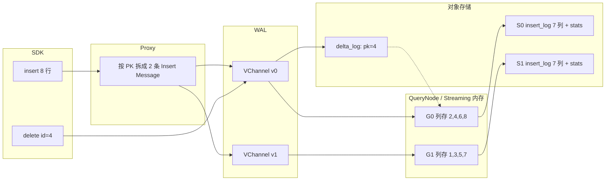

# Milvus 原理（一）：数据如何存储

> **系列索引**：[README.md](./README.md)
> **本篇边界**：从 `insert` / `delete` 进入 Proxy，到 WAL、growing segment、flush 成对象存储上的列式 binlog。不展开 search 执行（见 [第 2 篇](./02-query.md)）和索引文件（见 [第 3 篇](./03-index.md)）。

> **图表**：文中用 [Mermaid](https://mermaid.js.org/)。Cursor 需 Markdown Preview Mermaid 扩展；GitHub 可直接渲染。

---

## 1. 本篇要回答的问题

| 问题 | 本篇 |
|------|------|
| Collection / Partition / Shard / Segment 各管什么？ | ✅ |
| 一行书记录在内存里是按行还是按列？ | ✅ |
| WAL 和对象存储各自是什么角色？ | ✅ |
| Flush 之后磁盘路径长什么样？ | ✅ |
| Delete 存在哪里？为什么有 L0 segment？ | ✅ |

---

## 2. 数据组织：四层盒子

Milvus 没有「一张大表文件」。用户看见的是 Collection，物理上拆成多层，便于并行写、并行搜、失败只搬一块。

```text
Collection  books
├── Partition  _default          （逻辑分组，可省略）
│   ├── Shard 0  = VChannel …v0   （按 PK hash）
│   │   ├── Growing segment  G0   （还在写）
│   │   └── Sealed / Flushed S0   （已封闭，可建索引）
│   └── Shard 1  = VChannel …v1
│       ├── Growing segment  G1
│       └── Sealed / Flushed S1
```

| 概念 | 作用 | 对应本例 |
|------|------|----------|
| **Collection** | 带 schema 的表 | `books` |
| **Partition** | 查询时可裁剪的逻辑子集 | 本例只用 `_default` |
| **Shard / VChannel** | 写入与检索的并行单位；同一 PK 永远同一 shard | 偶数 PK → 0，奇数 → 1 |
| **Segment** | 真正存行和索引的最小单元 | G0/S0、G1/S1 |

QueryNode 调度、副本、compaction 都以 **segment** 为粒度。

源码对照：

- 分片名：`by-dev-rootcoord-dml_0_<collectionID>v0`（`docs/agent_guides/streaming-system/channel/channel.md`）
- 系统列 FieldID：`RowID=0`，`Timestamp=1`，用户字段从 `100` 起（`pkg/common/common.go`）

---

## 3. 贯穿示例：八行怎么进系统

客户端一次插入（伪代码）。`embedding` 来自 `encode_books.py`：`all-MiniLM-L6-v2(title)` → PCA→2 维（见 [README](./README.md)）：

```python
client.insert("books", [
  {"id": 1, "title": "Milvus Internals", "category": "tech",    "year": 2024, "embedding": [0.0724, 0.9974]},
  {"id": 2, "title": "Vector Search",    "category": "tech",    "year": 2023, "embedding": [0.9666, -0.2564]},
  {"id": 3, "title": "The Great Novel",  "category": "fiction", "year": 2020, "embedding": [-0.9253, -0.3791]},
  {"id": 4, "title": "Database Systems", "category": "tech",    "year": 2022, "embedding": [0.9908, 0.1352]},
  {"id": 5, "title": "Poetry of Spring", "category": "fiction", "year": 2021, "embedding": [-0.9686, -0.2485]},
  {"id": 6, "title": "HNSW Paper",       "category": "tech",    "year": 2016, "embedding": [-0.6759, 0.7370]},
  {"id": 7, "title": "Mystery Island",   "category": "fiction", "year": 2019, "embedding": [-0.0369, -0.9993]},
  {"id": 8, "title": "Knowhere Guide",   "category": "tech",    "year": 2025, "embedding": [0.4056, -0.9141]},
])
```

### 3.1 Proxy：校验 + 按 PK 拆消息

当前写入走 Streaming 路径：`insertTask.Execute` 取 VChannel 列表，按主键把行拆到各 channel，再 `WAL().AppendMessages`（`internal/proxy/task_insert_streaming.go`）。

本例拆完：

| VChannel | 行（PK） | 即将进入的 growing segment |
|----------|----------|----------------------------|
| shard 0 | 2, 4, 6, 8 | G0 |
| shard 1 | 1, 3, 5, 7 | G1 |

每一行还会带上：

- **RowID**：系统分配的内部行号（不是用户 `id`）
- **Timestamp**：可见性时钟，后面 query 用它做 MVCC

### 3.2 WAL：先落日志，才算写入成功

Milvus 的**唯一真相源是 WAL**，不是先写对象存储。Insert/Delete 都是一条 Message，带单调递增的 **TimeTick**。

```text
Client → Proxy → StreamingClient.Append → StreamingNode → WAL Backend
                 （Kafka / Pulsar / Woodpecker / RocksMQ）
```

同一 VChannel 上的消息顺序确定。QueryNode 的 Delegator 和 Flusher 都按这个顺序消费：一边喂内存 growing segment，一边攒批刷盘。

Shard interceptor 给每条 DML 指定当前 **growing segment**；满了就 seal（`internal/streamingnode/server/wal/interceptors/shard/`）。

Seal 常见触发（`seal_policy.go`）：容量、binlog 个数、存活时间、空闲、节点内存、挡住 L0 删除等。

---

## 4. Growing segment：内存里的列存

用户以为插入的是「一行一行的书」。Segcore 里立刻变成 **按列的 ConcurrentVector**，列再切成 chunk（`docs/archive/milvus-2.0/segcore/segment_growing.md` 与 `SegmentGrowingImpl` 仍符合当前实现）。

**G0（shard 0）内存列视图：**

```text
offset     0          1          2          3
id         2          4          6          8
title      Vector…    Database…  HNSW…      Knowhere…
category   tech       tech       tech       tech
year       2023       2022       2016       2025
embedding  [0.97,-0.26][0.99,0.14][-0.68,0.74][0.41,-0.91]
Timestamp  t2         t4         t6         t8
```

**G1（shard 1）：**

```text
offset     0          1          2          3
id         1          3          5          7
title      Milvus…    Great…     Poetry…    Mystery…
category   tech       fiction    fiction    fiction
year       2024       2020       2021       2019
embedding  [0.07,1.00][-0.93,-0.38][-0.97,-0.25][-0.04,-1.00]
```

插入两步（可并发 copy）：

1. `PreInsert(size)` 串行预留 offset 区间
2. `Insert(offset, …)` 把各列写入预留区间，再 ack

**为什么按列？** 向量检索和标量过滤都是「整列 SIMD / 建索引」，不需要每次把 title、year 和向量绑成一行。

Growing 上还可以给每个 chunk 建很小的临时向量索引（interim index），让未 flush 的数据也不必纯暴力扫（第 3 篇）。

内存结构对应 Go 侧的 `InsertData`：`map[FieldID]FieldData`（`internal/storage/insert_data.go`）。

---

## 5. Flush：列变成对象存储上的 binlog

Growing 被 seal 之后，Flusher 把列写成 **binlog**，上传对象存储（MinIO / S3 等），DataCoord 记下路径。状态大致：

```text
Growing  →  Sealed（不再接受新 insert）  →  Flushed（binlog 已持久化）
```

`Flush` 对 SDK 往往是异步的：先 seal，再等 DataNode/Flusher 把文件写完、`SaveBinlogPaths` 提交元数据。

### 5.1 对象路径（Storage V1/V2 经典布局）

路径由 `pkg/util/metautil/binlog.go` 拼出：

```text
{root}/insert_log/{collectionID}/{partitionID}/{segmentID}/{fieldID}/{logID}
{root}/delta_log/{collectionID}/{partitionID}/{segmentID}/{logID}
{root}/stats_log/{collectionID}/{partitionID}/{segmentID}/{fieldID}/{logID}
```

假设 `collectionID=1001`，`partitionID=2001`，G0 flush 成 `segmentID=3001`，则 **S0 在对象存储上至少有这些文件**（每列一个 insert binlog）：

```text
files/insert_log/1001/2001/3001/0/1      # RowID
files/insert_log/1001/2001/3001/1/1      # Timestamp
files/insert_log/1001/2001/3001/100/1    # id
files/insert_log/1001/2001/3001/101/1    # title
files/insert_log/1001/2001/3001/102/1    # category
files/insert_log/1001/2001/3001/103/1    # year
files/insert_log/1001/2001/3001/104/1    # embedding
files/stats_log/1001/2001/3001/100/1     # 主键 Bloom + min/max
```

S1（`segmentID=3002`）同样一套，只是行是 1,3,5,7。

同一列可以有多个 logID（多次 sync 追加）；QueryNode load 时按 logID 排序拼回（`InsertCodec` / `BlobList.Less`）。

### 5.2 单个 binlog 文件长什么样

Magic number `0xfffabc`，然后一串 event。第一个必须是 **Descriptor Event**（collection/partition/segment/field、时间范围、payload 类型）。Insert 的 payload 是 **Parquet 列数据**。

```text
[ magic 0xfffabc ]
[ DescriptorEvent: FieldID=104, dim=2, FLOAT_VECTOR, ts 范围 ]
[ InsertEvent: Parquet( embedding 四行 ) ]
```

实现：`internal/storage/binlog_writer.go`、`docs/archive/milvus-2.0/developer_guides/chap08_binlog.md`。

`category` 列的 Parquet 逻辑内容就是 `["tech","tech","tech","tech"]`，和内存列一致——**磁盘也是列存**。

### 5.3 PK stats：给删除和查询裁剪用

Flush 时对主键列生成 Bloom Filter + min/max（`InsertCodec.SerializePkStats`，`internal/storage/pk_statistics.go`）。

S0 的 stats 大约是：

- `minPK=2, maxPK=8`
- Bloom 里有 `{2,4,6,8}`

后面 Delegator 做 `delete id=4` 或 `id == 1` 时，用这份 stats **不必打开所有 segment 的数据文件**。

### 5.4 Storage V3（了解即可）

新格式用 **manifest** 描述一个 segment：列组文件（Parquet/Vortex）、delta、stats、index。目录形如 `_data/`、`_delta/`、`_stats/`、`_index/`、`_metadata/manifest-{ver}.avro`（`docs/design-docs/design_docs/20260226-manifest-format.md`）。DataCoord 用 `SegmentInfo.manifest_path` 指向当前可见版本。本篇示例仍按经典 `insert_log/.../fieldID/logID` 讲解，语义相同：一份不可变列文件 + 一份元数据指针。

---

## 6. Delete：数据文件通常不改，只记墓碑

```python
client.delete("books", filter="id == 4")
```

删除 **不会** 立刻重写 S0 的 insert binlog。WAL 上追加 Delete Message；持久化成 **delta log**（主键 + 删除时间戳）。

L0 段在 QueryNode 里甚至可以只持有 PK 列表（`internal/querynodev2/segments/segment_l0.go` 的 `pks` / `tss`），不参与向量 search。

查询时：先在候选行上应用 delete bitset（再叠加标量过滤）。PK=4 在 S0 offset=1，bitset 该位置为「不可见」。

**L0 compaction**（`Level0DeleteCompaction`）之后，删除会被应用到 L1 数据段，生成新的 insert binlog，旧文件由 GC 回收。在此之前，读路径必须同时看数据段 + 删除缓冲 / L0。

---

## 7. 把示例画成一张图



**读时看到的有效行：** `{1,2,3,5,6,7,8}`。PK=4 仍在 S0 的 `id` / `embedding` 列里，只是被 delete bitset 挡掉。这就是 LSM 风格：写放大换成就地 append。

---

## 8. 和「普通数据库一行一个 page」差在哪

| | 行存 OLTP | Milvus segment |
|--|-----------|----------------|
| 写入 | 可能原地更新 | WAL append + 列式 binlog append |
| 删除 | 常改页 / undo | delta log + 日后 compaction |
| 向量 | 一般没有 | 整列连续 float，便于 SIMD / 建 HNSW |
| 并行 | 表或分区 | **shard × segment**，search 天然 scatter-gather |

---

## 9. 源码地图

| 步骤 | 位置 |
|------|------|
| Insert 进 WAL | `internal/proxy/task_insert_streaming.go` |
| Channel / TimeTick | `docs/agent_guides/streaming-system/` |
| 分配 growing segment | `internal/streamingnode/server/wal/interceptors/shard/` |
| 内存列 + chunk | `internal/core/src/segcore/SegmentGrowingImpl.*` |
| `InsertData` / codec | `internal/storage/insert_data.go`, `data_codec.go` |
| Binlog 读写 | `internal/storage/binlog_writer.go`, `binlog_reader.go` |
| 对象路径 | `pkg/util/metautil/binlog.go` |
| PK Bloom | `internal/storage/pk_statistics.go` |
| L0 段 | `internal/querynodev2/segments/segment_l0.go` |

下一篇用同一批 8 行 + delete，走完一次 `search`。
