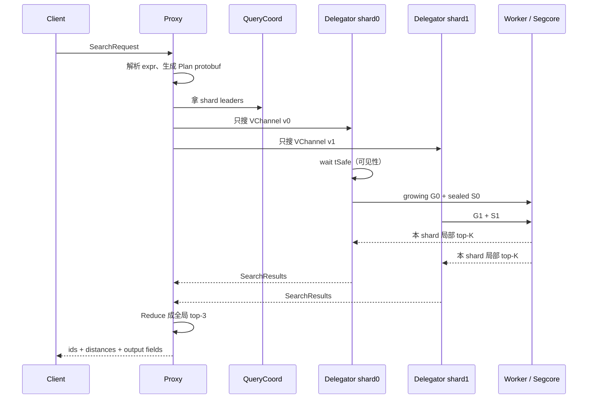

# Milvus 原理（二）：数据如何查询

> **系列索引**：[README.md](./README.md) · 上一篇：[存储](./01-storage.md) · 下一篇：[索引](./03-index.md)
> **本篇边界**：从 `search` / `query` 进 Proxy，经 QueryCoord / Delegator / Worker，到 Segcore 算出 top-K 并在 Proxy 上 Reduce。索引内部算法放第 3 篇。

---

## 1. 本篇要回答的问题

| 问题 | 本篇 |
|------|------|
| `search` 和 `query` 差在哪？ | ✅ |
| 请求怎么打到「对的」QueryNode？ | ✅ |
| 过滤、删除、向量检索谁先谁后？ | ✅ |
| Growing 和 Sealed 如何一起搜？ | ✅ |
| 多 shard 的结果怎么合成一条 top-3？ | ✅ |

---

## 2. 两种读：Query vs Search

| API | 本例 | 引擎在干什么 |
|-----|------|----------------|
| **Query** | `id == 1` 或 `year > 2020` | 标量表达式 → 行号 → 回表填列。像 `SELECT` |
| **Search** | `embedding` 近邻 + 可选 `expr` | 先（或边）过滤，再 ANN/暴力算距离，取 top-K |

本系列主线：

```python
client.search(
    collection_name="books",
    data=[[0.7283, 0.6853]],  # encode("Milvus HNSW vector search") → PCA
    anns_field="embedding",
    limit=3,
    filter='category == "tech"',
    output_fields=["title", "year"],
)
```

期望（[README](./README.md) 真值表）：PK **1, 2, 6**，书名 Milvus Internals / Vector Search / HNSW Paper。

---

## 3. 总路径



关键约束（`QueryNode.Search`）：**一次内部 SearchRequest 只带 1 个 DmlChannel**。Proxy 按 shard 扇出，最后自己 merge。

源码：

- Proxy 入口：`internal/proxy/impl.go` → `searchTask`
- 扇出：`searchTask.Execute` 里 `lb.Execute`（`internal/proxy/task_search.go`）
- QueryNode：`internal/querynodev2/services.go` `Search` → `searchChannel`
- Delegator：`internal/querynodev2/delegator/delegator.go` `Search`

---

## 4. Proxy 做了哪些「还没搜向量」的事

1. **Schema / CollectionID**，把字段名换成 FieldID（`embedding` → 104）。
2. **解析 filter** 为逻辑计划，再序列化成 `SerializedExprPlan`，QueryNode 不再从字符串重新解析一套语义。
3. **PlaceholderGroup**：查询向量 `[[0.7283, 0.6853]]` 打成二进制，`nq=1`。
4. **一致性**：`GuaranteeTimestamp`。Strong 会等 WAL 到这个点；Bounded/Session 可以更松。
5. **负载均衡**：向 QueryCoord 要各 shard 的 leader（Delegator），把请求打过去。

如果 filter 里有 **主键谓词**（`id == 1`），Proxy 还会设 `pk_filter` hint，Delegator 用 Bloom/min-max **直接丢掉不可能的 sealed segment**，Worker 都不用调（`docs/design-docs/.../20260324-segment_filter_pk_predicate_pruning.md`）。本例 filter 是 `category`，走不到 PK 裁剪，两个 shard 都要搜。

---

## 5. Delegator：一个 shard 的「指挥」

每个 VChannel 有一个 **ShardDelegator**（QueryNode v2，`20230418-querynode_v2.md`）：

- 消费该 channel 的 insert/delete，维持 **growing** 最新
- 知道本 shard 上 sealed 段分布在哪些 Worker
- Search 时 **先等 tSafe ≥ GuaranteeTimestamp**，再 pin 可读的 growing + sealed 列表

```go
// delegator.go Search 摘要
req.Req.GuaranteeTimestamp = sd.speedupGuranteeTS(...)
tSafe, err = sd.waitTSafe(ctx, req.Req.GuaranteeTimestamp)
req.Req.MvccTimestamp = tSafe   // 若请求没自带 MVCC
sealed, growing, ... = sd.distribution.PinReadableSegments(...)
results = sd.search(ctx, req, sealed, growing, ...)
```

**本例 tSafe 含义**：insert 8 行和 delete id=4 的 TimeTick 都已经确认，搜索不能看见「还在 WAL 里没 ack」的行，也不能漏掉已确认的删除。

Delegator 把子任务按 Worker 分组（`organizeSubTask`）：本机 growing 自己搜，远程 sealed 走 gRPC `SearchSegments`。

---

## 6. Segcore 里一次 segment 搜索

Worker 把请求交给 `LocalSegment.Search` → CGO → C++ plan 执行器。向量段的核心算子是 `PhyVectorSearchNode`（`internal/core/src/exec/operator/VectorSearchNode.cpp`）。

典型 **pre-filter** 管道：

```text
FilterBitsNode          # category == "tech" → 行 bitset
    → MvccNode          # Timestamp ≤ mvcc 且未被 delete
    → VectorSearchNode  # 只在 bitset 为 1 的行上算距离 / 走索引
```

bitset 约定：**1 = 可见且通过过滤，可以参与 ANN**。Knowhere 的 `Query(..., BitsetView blacklist)` 用这份视图跳过已删/已过滤行。

另有 **iterative filter**：先 ANN 出一批候选，再在候选上跑标量表达式，召回不够就扩大搜索。高选择率过滤时更划算。本例 `category=="tech"` 大约一半行，两种都能用；实现按代价选。

### 6.1 在 S0 上走一遍（4 行，已 flush）

S0 行：offset 0..3 = PK 2, 4, 6, 8。

| offset | PK | category | delete? | filter tech? | 最终 bitset |
|-------:|---:|----------|:-------:|:------------:|:-----------:|
| 0 | 2 | tech | 否 | ✓ | 1 |
| 1 | 4 | tech | **是** | ✓ | **0** |
| 2 | 6 | tech | 否 | ✓ | 1 |
| 3 | 8 | tech | 否 | ✓ | 1 |

无索引时，对 bitset=1 的三个向量算 L2(`q=[0.7283, 0.6853]`)：

| PK | 距离 |
|---:|-----:|
| 2 | 0.9714 |
| 6 | 1.4052 |
| 8 | 1.6316 |

本段局部 top-3：`2, 6, 8`。

有 HNSW/IVF 时，同一 bitset 交给 `SearchOnSealedIndex` → `vec_index->Query`（`internal/core/src/query/SearchOnSealed.cpp`）。索引**不会**把 PK=4 搜回来：图/倒排里也许还在，但 bitset 把它屏蔽了。

### 6.2 在 S1 上

行 PK 1,3,5,7。fiction 全灭，只剩 PK=1。

| PK | 距离 |
|---:|-----:|
| 1 | 0.7264 |

局部结果：只有 `1`。

### 6.3 Growing 还没 flush 时

若 8 行仍在 G0/G1：`SearchOnGrowing`（`SearchOnGrowing.cpp`）。

- 若 chunk 已建 interim index：走小索引
- 否则对每个 chunk 暴力扫，再在 segment 内 Reduce

**可见行数在计划时冻结**（`search_info_.active_count_`）。Concurrent insert 新 ack 的行不能挤进这次 search 的 top-K，否则 MVCC 会穿。

---

## 7. Reduce：两路局部结果变成全局 top-3

| 来源 | 候选 (PK, L2) |
|------|----------------|
| shard 0 | (2, 0.9714), (6, 1.4052), (8, 1.6316) |
| shard 1 | (1, 0.7264) |

Proxy `PostExecute` 收集各 channel 的 `SearchResults`，按度量合并截断（`task_search.go`）。L2 越小越好：

```text
全局排序: 1 (0.7264), 2 (0.9714), 6 (1.4052)     → limit=3
丢掉:     8 (1.6316)
```

若 `output_fields` 很大，可能先 search 只拿 PK/距离，再 **requery** 按 PK 拉 title/year（`requeryThreshold`）。本例字段小，往往一次带回。

---

## 8. Query（点查）在同一套存储上怎么走

```python
client.query(collection_name="books", filter="id == 6", output_fields=["title"])
```

没有 ANN：表达式 + PK 索引/Bloom 定位 segment → `Retrieve` 按 offset 填列。Delegator 对 `id==6` 可把 S1 整段剪掉（S1 的 Bloom 没有 6，min/max 是 1～7 仍可能误判，Bloom 进一步否决）。

Delete 同样靠 bitset：`id==4` 在 query 里返回空。

---

## 9. 一致性：为什么 search 要等 tSafe

Milvus 允许 WAL 与内存索引异步追平。查询带一个逻辑时间 T：

- 只接受 `Timestamp ≤ T` 的 insert
- 必须应用 `Timestamp ≤ T` 的 delete

Delegator 的 tSafe 就是「本 channel 已经追到这里」。等 tSafe 不是为了慢，而是为了 **8 行和 delete 4 在两个 replica 上看到同一快照**。

---

## 10. 源码地图

| 步骤 | 位置 |
|------|------|
| Search RPC | `internal/proxy/impl.go` `Search` |
| 计划 / 扇出 / Reduce | `internal/proxy/task_search.go` |
| QueryNode 入口 | `internal/querynodev2/services.go` |
| 等 tSafe、pin 段 | `internal/querynodev2/delegator/delegator.go` |
| 调 C++ | `internal/querynodev2/segments/segment.go` `LocalSegment.Search` |
| 过滤 + 向量算子 | `internal/core/src/exec/operator/VectorSearchNode.cpp` |
| Growing / Sealed 检索 | `SearchOnGrowing.cpp`, `SearchOnSealed.cpp`, `SearchOnIndex.cpp` |

有了「在 bitset 上找近邻」这条流水线，第 3 篇只需要说：bitset 圈出来的行，如何用 IVF/HNSW **少算距离**。
