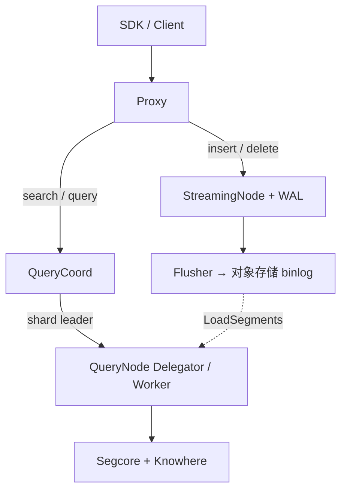

# Milvus 原理：存储 · 查询 · 索引

> 以同一批 **图书向量检索** 数据贯穿全系列。论点对照当前仓库源码（`/root/work/milvus`），不是 2.0 归档文档的旧架构。

## 本系列要回答的三件事

| 篇 | 问题 | 文件 |
|----|------|------|
| **1** | 一行 insert 最终落在内存、WAL、对象存储的哪里？ | [01-storage.md](./01-storage.md) |
| **2** | 一次 `search` / `query` 如何从 Proxy 走到 Segcore？ | [02-query.md](./02-query.md) |
| **3** | 向量索引 / 标量索引怎样少算距离、少扫行？ | [03-index.md](./03-index.md) |

---

## 贯穿示例：collection `books`

教学用 **2 维** 向量（生产常见 128～1536 维，算法一样）。度量 **L2**。`shards_num = 2`。

向量**不是手填坐标**，由书名经编码器得到后再投影到 2 维，便于画图：

```text
all-MiniLM-L6-v2(title)  →  384-d（L2 normalize）
         ↓ PCA(n=2, random_state=42) + L2 normalize
      embedding dim=2   （下文表格 / 插图用的就是这一列）
```

查询向量同样编码：`QUERY_TEXT = "Milvus HNSW vector search"` → PCA 变换 → `[0.7283, 0.6853]`。

再生：`python encode_books.py`（依赖见 `requirements.txt`），产物 `books_embeddings.json`。

### Schema

| FieldID | 字段 | 类型 | 说明 |
|--------:|------|------|------|
| 0 | `RowID` | INT64 | 系统列 |
| 1 | `Timestamp` | INT64 | 系统列，MVCC |
| 100 | `id` | INT64 | 主键 |
| 101 | `title` | VARCHAR | 书名（编码输入） |
| 102 | `category` | VARCHAR | `tech` / `fiction` |
| 103 | `year` | INT64 | 出版年 |
| 104 | `embedding` | FLOAT_VECTOR dim=2 | PCA 后的教学向量 |

### 八本书（insert）

| PK `id` | title | category | year | embedding（PCA 2-d） | 教学分片（见下） |
|--------:|-------|----------|-----:|----------------------|------------------|
| 1 | Milvus Internals | tech | 2024 | `[0.0724, 0.9974]` | shard 1 |
| 2 | Vector Search | tech | 2023 | `[0.9666, -0.2564]` | shard 0 |
| 3 | The Great Novel | fiction | 2020 | `[-0.9253, -0.3791]` | shard 1 |
| 4 | Database Systems | tech | 2022 | `[0.9908, 0.1352]` | shard 0 |
| 5 | Poetry of Spring | fiction | 2021 | `[-0.9686, -0.2485]` | shard 1 |
| 6 | HNSW Paper | tech | 2016 | `[-0.6759, 0.7370]` | shard 0 |
| 7 | Mystery Island | fiction | 2019 | `[-0.0369, -0.9993]` | shard 1 |
| 8 | Knowhere Guide | tech | 2025 | `[0.4056, -0.9141]` | shard 0 |

**分片规则（教学）**：偶数 PK → shard 0，奇数 PK → shard 1。生产上是 `hash(pk) % shards_num`（Proxy 的 `assignChannelsByPK`），不是奇偶。

**一次删除**：`delete id = 4`（Database Systems）。查询时应看不到这本书。

### 贯穿查询

```text
search:
  data     = [[0.7283, 0.6853]]   # encode("Milvus HNSW vector search") → PCA
  anns_field = embedding
  limit    = 3
  metric   = L2
  filter   = category == "tech"
```

无索引时的真值（过滤后只剩 tech，且 id=4 已删）：

| PK | L2 到 `[0.7283, 0.6853]` | 是否进入 top-3 |
|---:|-------------------------:|:--------------:|
| 1 | 0.7264 | ✓ |
| 2 | 0.9714 | ✓ |
| 6 | 1.4052 | ✓ |
| 8 | 1.6316 | （第 4 名） |
| 4 | 0.6095 | 已删除 |

精确 top-3：**1, 2, 6**（Milvus Internals / Vector Search / HNSW Paper）。

---

## 模块边界



| 组件 | 职责 |
|------|------|
| Proxy | 校验 schema、按 PK 拆 shard、发 WAL、把 search 打到各 shard leader |
| StreamingNode | WAL 唯一真相源；给 insert 分配 growing segment |
| DataCoord | 管 segment 元数据、flush 完成、建索引任务、compaction |
| QueryCoord | Load / 副本 / 选 shard leader |
| QueryNode | Delegator 消费实时写入 + 转发；Worker 在 sealed/growing 上算 |
| Segcore (C++) | 列存、表达式 bitset、向量检索 |
| Knowhere | 统一 IVF / HNSW 等 ANN 引擎 |

---

## 推荐阅读顺序

1. 本文：记住 8 行 + 1 次 delete + 那条 filtered search。
2. [第 1 篇 存储](./01-storage.md)
3. [第 2 篇 查询](./02-query.md)
4. [第 3 篇 索引](./03-index.md)
