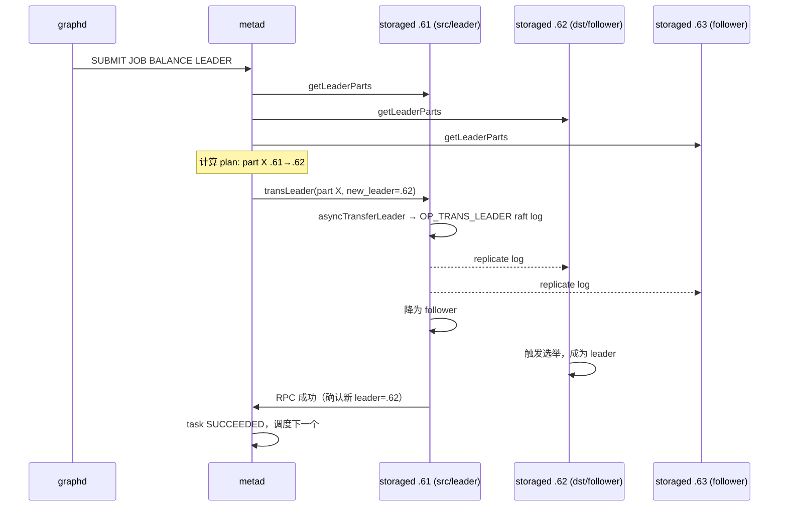

# BALANCE LEADER：rebalance leader 时序

> `SUBMIT JOB BALANCE LEADER` 只迁移 **raft leader 角色**，不搬 partition 数据副本。
> 源码入口：`LeaderBalanceJobExecutor`（metad）、`TransLeaderProcessor`（storaged）、`Part::asyncTransferLeader`（raft `OP_TRANS_LEADER`）。

## 命令

```sql
SUBMIT JOB BALANCE LEADER;
-- 或指定 partition / 目标 host
SUBMIT JOB BALANCE LEADER PARTITION <part_id> [TO "host":9779];
```

## 时序图（单个 partition）

以 part X 从 `.61`（例如为现 leader）迁到 `.62` 为例：




## 阶段说明


| 阶段  | 组件                   | 动作                                                        |
| --- | -------------------- | --------------------------------------------------------- |
| 提交  | graphd → metad       | 创建 `JobType::LEADER_BALANCE`，生成 `BalancePlan` 并持久化        |
| 采集  | metad → 各 storaged   | `getLeaderParts`：汇总每台机器担任 leader 的 `(space, partId)`      |
| 规划  | metad                | 按 `leader_balance_deviation`（默认 5%）计算 acquire/giveup 任务列表 |
| 下发  | metad → src storaged | `transLeader` RPC 打到**现 leader** 所在机器                     |
| 转移  | storaged (raft)      | `OP_TRANS_LEADER` 写入 raft log；src 让出 leader，dst 触发选举      |
| 确认  | src storaged → metad | 轮询本地 `partLeader()`，确认新 leader 不是 src 后返回成功               |
| 续调度 | metad                | 更新 task 状态，按 `task_concurrency`（默认 10）继续下一批               |


## 相关源码


| 路径                                                     | 说明                                            |
| ------------------------------------------------------ | --------------------------------------------- |
| `src/meta/processors/job/LeaderBalanceJobExecutor.cpp` | 计划生成、任务调度                                     |
| `src/meta/processors/admin/AdminClient.cpp`            | `transLeader` / `getLeaderDist` RPC           |
| `src/storage/admin/AdminProcessor.h`                   | `TransLeaderProcessor`                        |
| `src/storage/admin/GetLeaderProcessor.cpp`             | `getLeaderParts`                              |
| `src/kvstore/Part.cpp`                                 | `asyncTransferLeader` → `OP_TRANS_LEADER`     |
| `src/kvstore/raftex/RaftPart.cpp`                      | `preProcessTransLeader` / `commitTransLeader` |


