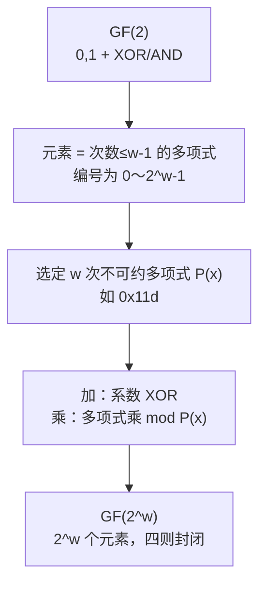
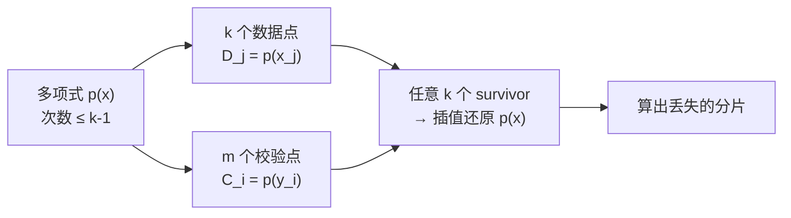
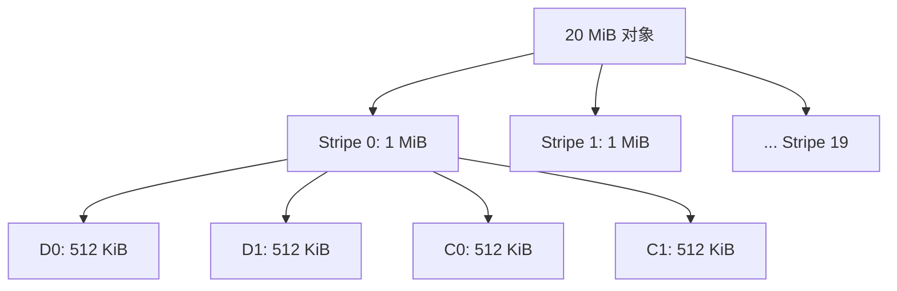
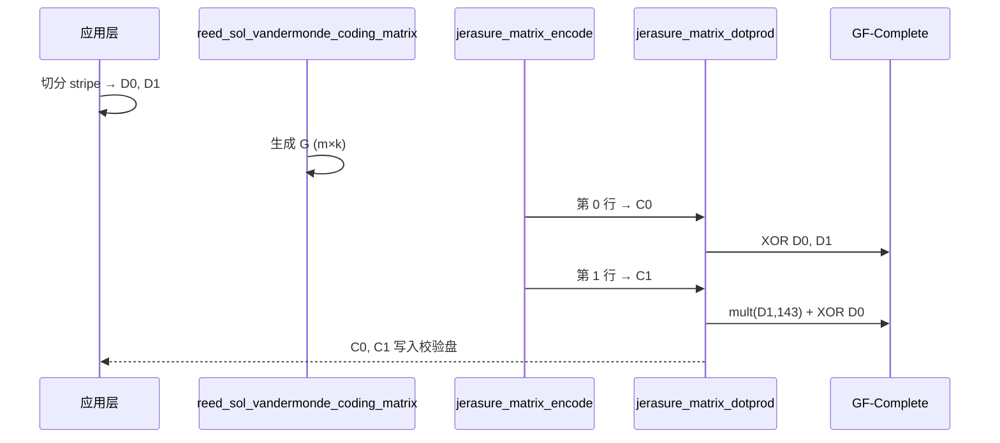

# Reed-Solomon 纠删码原理

> **阅读目标**：理解对象存储里 **EC k+m**（如 2+2、4+2）背后的数学与工程实现——**有限域 → Vandermonde 矩阵 → 生成矩阵 → 编解码**；数据如何切条、为何任意 k 块可恢复。
>
> **贯穿示例**：20 MiB 对象，**k=2** 数据盘 + **m=2** 校验盘，**w=8**（GF(2⁸)），与 [Jerasure](https://github.com/ceph/jerasure) / MinIO / RustFS 同类 RS 方案一致。

---

## 1. 为什么需要纠删码

对象存储要把用户对象 **持久、廉价、可扩展** 地放在多台机器/多块盘上。副本（3 副本）简单但空间开销大；**纠删码（Erasure Code, EC）** 用计算换空间：

| 方案 | 4 节点存 20 MiB 对象（示意） | 可容忍故障 |
|------|------------------------------|------------|
| 3 副本 | ~60 MiB | 任意 2 节点 |
| EC 2+2 | ~40 MiB（每盘 10 MiB） | 任意 2 节点 |

**EC 2+2** 表示：4 块里 **2 块是原始数据分片**，**2 块是校验分片**；**任意丢失 2 块**，剩余 2 块即可恢复全部 20 MiB。

---

## 2. 核心参数

| 符号 | 名称 | 含义 |
|------|------|------|
| **k** | data shards | 数据分片数 |
| **m** | parity shards | 校验分片数 |
| **n** | total | n = k + m，总分片数 |
| **w** | word size | Galois 域 GF(2^w) 的 w，常用 **8**（即 GF(256)） |
| **stripe** | 条带 | 一次 EC 运算处理的逻辑数据单元（如 1 MiB） |

**MDS 性质**：Reed-Solomon 是 **Maximum Distance Separable** 码——最多丢 **m** 块，只要还剩 **k** 块（任意哪 k 块），就能恢复原始数据。

---

## 3. 有限域 GF(2^w)

### 3.1 有限域是什么

**有限域（Galois Field）** 首先是一个 **集合**：里面只有 **有限个** 元素，并且在这个集合上定义了 **加法、减法、乘法、除法**（除 0 外都可除），且满足与普通四则运算类似的规律（结合律、分配律等），但 **结果永远不会跑出这个集合**。

可以把它理解成：我们不再在「全体整数」或「全体实数」里算，而是 **只允许在一小撮数字里算**——算完还在里面。

### 3.2 GF(2^8) 里有哪些数

对象存储里 Reed-Solomon 最常用 **GF(2^8)**，也记作 **GF(256)**。此时 **w = 8**，集合里的元素恰好是：

```text
{ 0, 1, 2, 3, …, 254, 255 }
```

也就是 **0 到 255，共 256 个数**。
每个字节（byte）的值本身就在这个范围内，所以 **一个字节天然对应 GF(2^8) 里的一个元素**——这也是 RS 编码常选 w=8 的原因。

更一般地，**GF(2^w)** 里一共有 **2^w** 个元素。例如 w=4 时有 16 个数，w=16 时有 65536 个数；Jerasure 常见 w=8、16、32。

### 3.3 为什么必须用有限域

若在普通整数里做 Vandermonde 编码，系数幂次会迅速变大，例如 3¹⁰ = 59049，**字节存不下，矩阵乘法也会「数字爆炸」**。
在 GF(2^8) 里，**任意加、乘、除的结果仍然落在 0～255**，不会溢出到集合外面。Reed-Solomon 的矩阵系数、分片上的每个字节，都可以稳定地表示和运算。

> **一句话**：有限域给 RS 提供了一个 **大小固定、四则封闭** 的算术世界；GF(2^8) 就是 **256 个元素、与 byte 对齐** 的那个世界。

### 3.4 如何构造 GF(2^w)

有限域不是「随便挑 256 个数」——它从 **GF(2)** 出发，通过 **扩域（extension field）** 严格构造出来。

#### 第一步：从 GF(2) 开始

**GF(2)** 只有两个元素：

```text
GF(2) = { 0, 1 }
```

运算极简单（就是比特运算）：

| 运算 | 规则 |
|------|------|
| 加法 | XOR：0+0=0, 0+1=1, 1+1=0 |
| 乘法 | AND：0×0=0, 0×1=0, 1×1=1 |

GF(2) 是后续一切 GF(2^w) 的「系数世界」。

#### 第二步：把元素表示成多项式

**GF(2^w)** 里的每个元素，都可以看成 **次数 ≤ w-1** 的多项式，系数只在 GF(2) 里（0 或 1）：

```text
a_{w-1} x^{w-1} + … + a_1 x + a_0     ，每个 a_i ∈ {0, 1}
```

用一个 **w 比特整数** 存系数向量 `(a_{w-1}, …, a_0)`，就得到 **0～2^w-1** 这 2^w 个元素。

**GF(2^8) 举例**（整数 ↔ 多项式）：

| 整数 | 二进制 | 多项式 |
|------|--------|--------|
| 0 | `00000000` | 0 |
| 1 | `00000001` | 1 |
| 2 | `00000010` | x |
| 3 | `00000011` | x + 1 |
| 5 | `00000101` | x² + 1 |
| 255 | `11111111` | x⁷+x⁶+…+x+1 |

所以第 3.2 节说的「0～255」不是普通整数，而是 **「最多 8 项的 GF(2) 多项式」的一种编号**。

#### 第三步：选一个 w 次「不可约多项式」

要在 GF(2) 上做多项式乘除且结果仍保持次数 ≤ w-1，需要固定一个 **w 次不可约多项式** P(x)（类似普通算术里「模一个质数」）。

对 **GF(2^8)**，工程上几乎统一用：

```text
P(x) = x⁸ + x⁴ + x³ + x² + 1
```

十六进制常写作 **`0x11d`**（9 比特 `(1)00011101`，最高位的 1 代表 x⁸）。

「不可约」意味着 P(x) 在 GF(2) 上不能再因式分解——保证每个非零元素都有乘法逆元，从而可以除。

#### 第四步：定义加法和乘法

- **加法**：两个多项式 **按系数 XOR**（各次项系数分别相加 mod 2）
  → 对应整数就是 **`a ^ b`**（按位异或）

- **乘法**：两个多项式 **先乘**，再 **除以 P(x) 取余**（余式次数 ≤ 7）
  → 结果仍落在 0～255

**例 1：3 + 1（加法）**

```text
3 = x+1 ,  1 = 1
(x+1) + 1 = x        →  整数 2
3 XOR 1 = 2          ✓（与 XOR 一致）
```

**例 2：3 × 3（乘法，不需要降次）**

```text
3 = x+1
(x+1)² = x² + 2x + 1 = x² + 1     （GF(2) 里 2=0，中间项消失）
     = x² + 1  →  二进制 101  →  整数 5

所以 GF(2^8) 里  3 × 3 = 5 ，不是 9。
```

**例 3：2 × 128（乘法，需要模 P(x)）**

```text
2 = x ,  128 = x⁷
x · x⁷ = x⁸

x⁸ 次数已是 8，必须模 P(x)：
  x⁸ ≡ x⁴ + x³ + x² + 1   (mod P(x))
     →  0x1d  →  整数 29

工程实现：对整数做「左移 1 位」，若溢出第 9 位则 XOR 0x11d——这就是 ×2 的快速算法。
```

#### 第五步：验证「封闭性」

任意两个 0～255 的元素：

- 相加（XOR）→ 仍在 0～255
- 相乘（多项式乘 + 模 P）→ 余式次数 ≤ 7 → 仍在 0～255
- 非零元有逆元 → 可以除

于是一个 **256 个元素的有限域** 构造完毕，记作 **GF(2^8)** 或 **GF(256)**。

#### 小结：构造链条



| w | 元素个数 | 常用不可约多项式 P(x) 示例 |
|---|----------|-------------------|
| 4 | 16 | 0x13 等 |
| 8 | 256 | **0x11d**（RS / Jerasure 默认） |
| 16 | 65536 | 由库初始化时指定 |

Jerasure 调用 `galois_init_default_field(8)` 时，GF-Complete 内部就是按上述规则建好 **256×256 乘法表** 和 **region multiply**，供 Vandermonde 编码使用（见第 4 节）。

### 3.5 运算规则

在 **已经构造好** 的 GF(2^w) 上，Reed-Solomon 代码里只需记住：

- **加法** = 按位 **XOR**（在 GF(2^w) 中，加法就是异或）
- **乘法** = 在多项式表示下相乘，再 **模一个 w 次不可约多项式**（w=8 时常用 `0x11d`，即 x⁸+x⁴+x³+x²+1）

> **易错点**：Vandermonde 第 i 行第 j 列是 **GF 里的 i^j**（在集合内做乘法、反复累乘），**不是**十进制里的幂。
> 例如 w=8 时 **3² = 5**（见 3.4 例 2 的手算推导），**3³ = 15**（5×3 继续在 GF 内乘）——都不是十进制幂。

```text
GF(2^8) 示例（结果都在 0～255 内）：
  3 × 3 = 5
  5 × 3 = 15
  1 + 1 = 0        （XOR：在 GF(2) 子结构里 1+1=0，字节级 XOR 同理）
  255 + 1 = 254    （举例：XOR 后仍在 0～255）
```

工程实现（如 Jerasure + GF-Complete）会预建 **256×256 乘法表** 或 **SIMD region multiply**，对整块 buffer 做标量乘，避免逐字节查表过慢。

---

## 4. Vandermonde 矩阵

读完 **有限域** 之后，还需要理解 Reed-Solomon 选用的那种 **生成矩阵从哪来**。经典 RS 方案的核心就是 **Vandermonde 矩阵**（范德蒙德矩阵）。

### 4.1 它是什么

**Vandermonde 矩阵**是一种特殊的矩阵：第 **i** 行、第 **j** 列（从 0 起计）的元素是某个底 **x_i** 的 **j 次幂**：

```text
第 i 行 = [ 1,  x_i,  x_i²,  x_i³,  …,  x_i^(k-1) ]
```

n 行 k 列时，整体形如（示意）：

```text
V = | 1   x₀   x₀²  …  x₀^(k-1) |
    | 1   x₁   x₁²  …  x₁^(k-1) |
    | …                          |
    | 1  x_(n-1) …  x_(n-1)^(k-1)|
```

在 **实数** 里，若各 **x_i 互不相等**，Vandermonde 矩阵 **可逆**——这是代数里的一条经典结论。

### 4.2 搬到 GF(2^w) 上

Reed-Solomon 不在实数里算，而在 **GF(2^w)** 里算（见第 3 节）：

- 矩阵里每个数都是 **0～2^w-1** 里的元素
- **x_i^j** 表示在 GF 里把 **x_i 连乘 j 次**，不是十进制幂

例如 **x=3, j=2** 时，在 GF(2^8) 里 **3² = 5**，不是 9。

**约束**：底 **x_i** 必须 **两两不同**，且都在 GF(2^w) 内。因此 Jerasure 要求 **k + m ≤ 2^w**——最多只能选出这么多个互不相同的求值点。

### 4.3 直觉：多项式求值

可以把 k 个数据分片 **D₀, D₁, …, D(k-1)** 看成某个 **次数 ≤ k-1** 的多项式 **p(x)** 在 k 个不同点上的取值：

```text
D_j = p(x_j)
```

再额外选 m 个不同的点 **y₀, y₁, …, y(m-1)**，计算 **m 个校验值**：

```text
C_i = p(y_i)
```

Vandermonde 结构保证：知道 **任意 k 个点** 的取值，就能 **唯一恢复** 多项式 **p(x)**，从而算出丢失的分片——这就是 RS **MDS**（最多丢 m 块仍可恢复）的代数根源。



### 4.4 为什么 RS 常用 Vandermonde

| 性质 | 含义 |
|------|------|
| **构造简单** | 每行只是「1, x, x², …」的幂次，代码里循环 `galois_single_multiply` 即可生成 |
| **MDS** | 任意 k 行线性无关（底互异时），丢 m 块仍可恢复 |
| **与 byte 对齐** | 配合 GF(2^8)，矩阵系数和分片字节同处 0～255 |
| **工程成熟** | MinIO、Jerasure、RustFS 等默认 Vandermonde 型 RS |

### 4.5 小例子：2×2 Vandermonde（在 GF 上）

取两个不同的底 **x₀=1, x₁=2**（均在 GF(2^8) 内）：

```text
V = | 1   1 |    ← 行 0：1, 1¹
    | 1   2 |    ← 行 1：1, 2¹（2 是 GF 元素，不是整数 2 的特殊含义）
```

若 **D = [D₀, D₁]ᵀ**，则 **V·D = [D₀+D₁, D₀+2·D₁]ᵀ**（加、乘都在 GF 上）。
第二行就是在 XOR 校验之外，再掺入 **2·D₁** 这类 GF 加权，使两行信息「足够不同」，丢一块时才能解方程。

### 4.6 Jerasure 的 Extended Vandermonde

工程库不直接把上面的 n×k 矩阵当 coding matrix，而是：

1. 构造 **(k+m) × k** 的 **Extended Vandermonde**（首尾行有特殊锚点，中间行是 **1, i, i², …**）
2. 在 GF 上做 **消元 / 归一化** → **distribution matrix**（前 k 行变成单位阵，便于解码）
3. **截取后 m 行** → 编码用的 **coding matrix G**

因此你在第 6 节看到的矩阵，是 **Vandermonde 家族经变换后的结果**；k=2 时第二校验行可能是 `[1, 143]` 而不是 `[1, 2]`，但 **本质仍是「幂次行 + GF 线性组合」**。

> **读完本节应建立的概念**：Vandermonde = **按不同底取幂次排成的矩阵**；在 GF 上用它把 k 个数据分片线性组合成 m 个校验分片；下一节先看对象如何切条，再第 6 节看具体矩阵长什么样。

---

## 5. 数据布局：对象 → 条带 → 分片

以 **20 MiB 对象、EC 2+2、stripe = 1 MiB** 为例：



- 每个 **stripe** 的用户数据（1 MiB）均分为 **k=2** 份 → 每数据盘 **512 KiB**
- 对同一 stripe 做一次 RS 编码 → 每校验盘也写入 **512 KiB**
- 20 个 stripe 依次 append 到各盘的 `part.1` 类文件中

**整对象视角**：每盘最终约 **10 MiB**（20 MiB ÷ k），集群合计 **40 MiB**。

---

## 6. 生成矩阵（Generator / Coding Matrix）

### 6.1 矩阵–向量形式

把 k 个数据分片看作列向量 **D**，m 个校验分片 **C**：

```math
C = G \cdot D
```

- **G** 是 **m × k** 矩阵，元素 ∈ GF(2^w)
- **D** = `[D₀, D₁, …, D(k-1)]`（列向量；每个 `D_j` 是 stripe 上的一段字节，逐字节在 GF 上运算）
- **C** = `[C₀, C₁, …, C(m-1)]`（列向量）

### 6.2 完整分布矩阵 (k+m) × k

Jerasure 先构造 **(k+m) × k** 的 **distribution matrix**：

- **前 k 行**：对应 k 个数据设备（变换后为 **单位阵 I_k**）
- **后 m 行**：对应 m 个校验设备 → 提取为 **coding matrix**

### 6.3 从 Vandermonde 到 coding matrix（Jerasure 流程）

第 4 节介绍了 Vandermonde 的数学含义；Jerasure 里实际编码用的是经变换后的 **coding matrix**。流程如下：


1. **Extended Vandermonde**：中间行第 i 列为 GF 幂 `[1, i, i², …]`，首尾行为边界锚点
2. **消元**：保证左上 k×k 可逆、第 k 行全 1（XOR 校验）、便于解码
3. **截取**：`coding_matrix[i*k+j] = dist[(k+i)*k+j]`

### 6.4 k=2, m=2, w=8 实测矩阵

**Extended Vandermonde（变换前）**：

```text
[1  0]
[1  1]
[1  2]    ← 第二列是 GF(2^8) 里的 2，不是十进制 2
[0  1]
```

**Distribution matrix（变换后）**：

```text
[1   0]   ← 数据盘 0
[0   1]   ← 数据盘 1
[1   1]   ← C0 = D0 ⊕ D1
[1 143]   ← C1 = D0 ⊕ 143·D1
```

**Coding matrix G（编码直接用，2×2）**：

```text
G = [1   1 ]
    [1 143]
```

> **说明**：k=2 时第二校验行系数是 **143** 而非 `[1,2]`，这是 distribution 变换的结果；k=4, m=2 时才会得到常见的 `[1,2,4,8]` 型 RAID-6 第二行。

### 6.5 一维数组存储

Jerasure 用 **行优先** 一维 `int*` 存 m×k 矩阵：

```text
element G[i][j]  →  matrix[i*k + j]
```

编码第 i 个校验块时：`matrix_row = matrix + i*k`。

---

## 7. 编码：G × D 如何实现

入口：`jerasure_matrix_encode()` → 对每一行调用 `jerasure_matrix_dotprod()`。

**伪代码**（一个 stripe、一个校验块 C_i）：

```text
acc ← 0
for j in 0..k-1:
    if G[i][j] == 0:   skip
    if G[i][j] == 1:   acc ← acc ⊕ D_j      (XOR)
    else:              acc ← acc ⊕ (G[i][j] ⊗ D_j)   (GF 标量乘 + XOR)
C_i ← acc
```

**k=2, m=2 展开**：

```text
C0 = D0 ⊕ D1
C1 = D0 ⊕ (143 ⊗ D1)
```

- 系数 **1** → `galois_region_xor`（纯 XOR）
- 系数 **143** → `galois_w08_region_multiply` 再 XOR 累加

> **注意**：dotprod 写入的是 **`coding_ptrs[i]`（校验块）**，不是把 D0/D1 再拷贝一遍；数据分片在编码前已由应用层填好。



---

## 8. 解码

丢失 ≤ m 块时，从任意 **k 个 survivor** 块构造 **k×k 解码矩阵**（对 survivor 对应行求逆），再对丢失块做同样的 dotprod 恢复。

**优化**：若 coding matrix **第 0 行全 1**（C0 = XOR），且 **只丢 1 个数据盘**、C0 还在 → 直接用 C0 XOR 其余数据盘恢复，无需求逆。

Jerasure：`jerasure_matrix_decode(..., row_k_ones=1, ...)`。

---

## 9. 与对象存储 EC 的对应关系

| 概念 | 对象存储（MinIO / RustFS） | Jerasure 术语 |
|------|---------------------------|---------------|
| 数据盘 | data shard / data drive | `D0` … `D(k-1)` |
| 校验盘 | parity shard | `C0` … `C(m-1)` |
| 条带 | stripe（如 1 MiB） | 一次 encode 的 `size` |
| 生成矩阵 | erasure coding matrix | `reed_sol_vandermonde_coding_matrix` |
| 域 | GF(2⁸) | w=8 |

RustFS 现代写入路径使用 Rust `reed-solomon-erasure`（GF(2⁸) Vandermonde + SIMD）；Jerasure 用 C + GF-Complete，**数学同类，API 与矩阵布局不同**。

---

## 10. 小结

| 步骤 | 做什么 |
|------|--------|
| 1 | 在 GF(2^w) 上理解有限域；用 Vandermonde 构造 MDS 生成矩阵（第 3～4 节） |
| 2 | 对象按 stripe 切为 k 个数据分片 D_j |
| 3 | **C = G·D**：每行 dotprod，系数 1 用 XOR，其余用 GF 乘 |
| 4 | k 个数据盘 + m 个校验盘各存一条 stripe；重复至对象结束 |
| 5 | 解码：丢 ≤m 块时，k survivor 行可逆即可恢复 |

---

## 11. 参考实现与本地示例

- **Jerasure**：`root/work/Jerasure`
  - 矩阵：`src/reed_sol.c`
  - 编码乘：`src/jerasure.c` → `jerasure_matrix_encode` / `jerasure_matrix_dotprod`
  - GF：`src/galois.c` + GF-Complete
- **本地 demo**：`Jerasure/Examples/reed_sol_demo_20mib.c`（20 MiB, k=2, m=2, w=8，打印各阶段矩阵）

```bash
cd /root/work/Jerasure
make -f Makefile.demo run
```

---

## 附录 A：符号对照

| 符号 | 含义 |
|------|------|
| ⊕ | GF 加法（XOR） |
| ⊗ | GF 乘法（标量乘） |
| V | Vandermonde 矩阵 |
| G | m×k coding matrix（Vandermonde 经变换后的编码子矩阵） |
| RS | Reed-Solomon |
| EC | Erasure Coding |
| MDS | Maximum Distance Separable |

---

## 附录 B：延伸阅读

- James S. Plank, *A Tutorial on Reed-Solomon Coding for Fault-Tolerance in RAID-like Systems*
- Jerasure / GF-Complete 文档：[jerasure.org](https://jerasure.org/)
- RustFS 架构：`rustfs/docs/architecture/erasure-coding.md`
